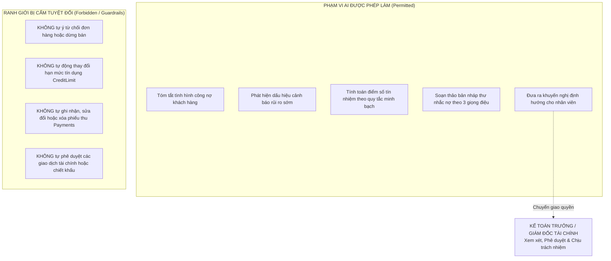
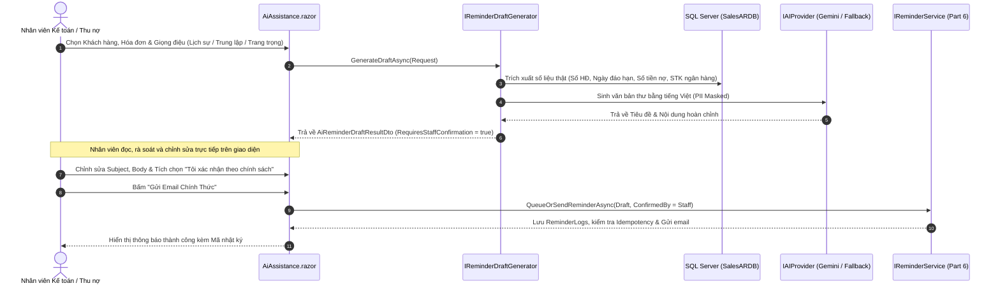

# TÀI LIỆU QUẢN TRỊ & KHUNG AN TOÀN TRỢ LÝ AI (PART 8/10)
## Đề tài 18: Bán hàng & Quản lý Công nợ Phải thu Khách hàng (Sales & AR)
## Tiêu chuẩn: AI Governance, Human-in-the-Loop & Financial Guardrails

---

## 1. Mục Tiêu & Triết Lý Ứng Dụng AI Trong Quản Trị Công Nợ

Trong hệ thống **SalesAR**, trí tuệ nhân tạo (AI) được định vị là **công cụ trợ lực thông minh (Augmented Intelligence)** hỗ trợ nhân viên kinh doanh, kế toán công nợ và giám đốc tài chính.

### 4 Nguyên tắc cốt lõi:
1. **Con người giữ quyền quyết định tối hậu (Human-in-the-Loop)**: AI không thay thế thẩm quyền pháp lý và trách nhiệm tài chính của con người. Mọi đề xuất từ AI đều cần nhân sự có thẩm quyền rà soát, hiệu chỉnh và xác nhận.
2. **Nguyên tắc Dữ liệu sự thật (Grounding & Zero Hallucination)**: Tuyệt đối không để AI tự bịa đặt số tiền, ngày đến hạn, hạn mức hoặc lịch sử giao dịch. Toàn bộ số liệu cốt lõi phải được trích xuất 100% từ cơ sở dữ liệu SQL Server (`SalesARDB`).
3. **Phân tách bạch giữa Sự thật và Lời diễn giải**: Giao diện và cấu trúc dữ liệu (DTO) luôn phân biệt rõ giữa `GroundTruth` (số liệu hệ thống xác thực) và `AiNarrative` (phần tổng hợp điều hành do AI tạo).
4. **Không tuyên bố phóng đại độ chính xác (Honest AI Transparency)**: Hệ thống công bố rõ ràng các giả định, phiên bản thuật toán (`v1.0-RuleBasedScoring`), và không đưa ra tuyên bố về độ chính xác tuyệt đối khi chưa qua quy trình kiểm định thống kê dài hạn trên tập dữ liệu lịch sử thực tế.

---

## 2. Ranh Giới Thẩm Quyền & Rào Cản An Toàn (AI Guardrails)

Hệ thống thiết lập các rào cản an toàn bất khả xâm phạm tại tầng kiến trúc phần mềm, ngăn chặn hoàn toàn việc AI can thiệp vào các quyết định tài chính trọng yếu:

### Chi tiết các giới hạn kỹ thuật:
- **Từ chối bán hàng**: Khi phát hiện khách hàng vượt hạn mức hoặc quá hạn nghiêm trọng, AI chỉ sinh cảnh báo `VƯỢT HẠN MỨC` và gắn nhãn `RequiresHumanReview = true`. Quyết định từ chối giao hàng thuộc về quy trình kiểm tra hạn mức bán hàng của Nhân viên kinh doanh và Kế toán trưởng.
- **Hạn mức tín dụng**: Bảng `dbo.Customers.CreditLimit` chỉ có thể được cập nhật thông qua luồng duyệt yêu cầu chính thức `ApproveCreditLimitRequestUseCase` (Part 5) với đầy đủ chữ ký người duyệt (`ApprovedBy`) và lưu vết kiểm toán (`AuditLogs`).
- **Ghi nhận thanh toán**: AI không có quyền tương tác với bảng `dbo.Payments` hoặc `dbo.PaymentAllocations`.

---

## 3. Mô Hình Chấm Điểm Rủi Ro Tín Dụng Minh Bạch (Credit Risk Assessment Matrix v1.0)

Theo quy định quản trị, khi chưa có đủ dữ liệu lịch sử dán nhãn nợ xấu (Default Labels) trong nhiều năm, hệ thống áp dụng **mô hình chấm điểm dựa trên quy tắc minh bạch (Explainable Rule-Based Scoring Matrix v1.0)** thay vì mô hình Machine Learning hộp đen (Black-box ML):

### 3.1. Thang điểm chuẩn (0.0 đến 100.0)
Mỗi khách hàng khởi đầu với điểm chuẩn là **100.0 điểm** (trạng thái lý tưởng). Điểm số bị khấu trừ tương ứng với các mức độ rủi ro phát hiện từ cơ sở dữ liệu:

| Nhóm Tiêu Chí | Dấu Hiệu Rủi Ro Phát Hiện | Điểm Trừ | Mức Độ Nghiêm Trọng |
| :--- | :--- | :---: | :---: |
| **1. Hạn mức tín dụng** | Dư nợ vượt quá hạn mức được cấp ($> 100\%$) | **-35 điểm** | `Danger` (Rất cao) |
| | Sử dụng từ $80\%$ đến $100\%$ hạn mức tín dụng | **-20 điểm** | `Warning` (Cảnh báo) |
| | Sử dụng từ $50\%$ đến $79\%$ hạn mức tín dụng | **-10 điểm** | `Normal` (Trung bình) |
| | Không có hạn mức nhưng phát sinh nợ tồn đọng | **-20 điểm** | `Warning` (Cảnh báo) |
| **2. Tuổi nợ & Quá hạn** | Có hóa đơn quá hạn nghiêm trọng trên $60$ ngày | **-30 điểm** | `Danger` (Rất cao) |
| | Có hóa đơn quá hạn từ $31$ đến $60$ ngày | **-20 điểm** | `Warning` (Cảnh báo) |
| | Có hóa đơn quá hạn ngắn hạn dưới $30$ ngày | **-10 điểm** | `Normal` (Trung bình) |
| **3. Tranh chấp / Khiếu nại**| Khách hàng đang có trạng thái `IsInDispute = 1` | **-20 điểm** | `Danger` (Rất cao) |
| **4. Lịch sử thanh toán** | Chưa từng có chứng từ thanh toán nào kể từ khi mở mã | **-15 điểm** | `Warning` (Cảnh báo) |
| | Đã quá $90$ ngày không có dòng tiền thanh toán mới | **-10 điểm** | `Warning` (Cảnh báo) |

### 3.2. Phân cấp mức độ rủi ro & Cơ chế bắt buộc người duyệt

$$\text{RiskScore} = \max(0, \min(100, 100 - \sum \text{Điểm trừ}))$$

| Thang Điểm | Phân Cấp Rủi Ro | Yêu Cầu Người Duyệt (`RequiresHumanReview`) | Khuyến Nghị Quản Trị Hệ Thống |
| :---: | :---: | :---: | :--- |
| **80.0 - 100.0** | **Thấp (Low)** | **Không** | Hồ sơ tài chính an toàn. Cho phép duy trì bán hàng và hạn mức bình thường. |
| **60.0 - 79.9** | **Trung bình (Medium)** | **Không** | Giám sát kỳ hạn hóa đơn sắp đáo hạn. Không cấp vượt hạn mức tín dụng. |
| **40.0 - 59.9** | **Cao (High)** | **CÓ (Bắt buộc)** | Tạm hoãn cấp thêm hạn mức. Yêu cầu thanh toán nợ quá hạn trước khi giao hàng mới. Kế toán trưởng xem xét hạ hạn mức. |
| **< 40.0** | **Nghiêm trọng (Critical)** | **CÓ (Bắt buộc)** | Đình chỉ bán chịu lập tức. Chuyển hồ sơ sang chế tài thu hồi nợ đặc biệt. Giám đốc Tài chính trực tiếp phê duyệt hướng xử lý. |

> [!CAUTION]
> **Quy tắc đè trạng thái tranh chấp**: Nếu khách hàng có cờ `IsInDispute = true`, hệ thống **luôn luôn thiết lập `RequiresHumanReview = true`** bất kể điểm số đạt bao nhiêu, đảm bảo không bỏ sót các trường hợp khiếu nại đang chờ xử lý.

---

## 4. Quy Trình Soạn Thảo & Kiểm Duyệt Thư Nhắc Nợ AI

Hệ thống cho phép nhân viên vận hành tạo thư nhắc nợ nhanh chóng qua `IReminderDraftGenerator`, hỗ trợ 3 giọng điệu (*Tone of Voice*):

---

## 5. Kiến Trúc Nhà Cung Cấp AI (`IAIProvider`) & An Toàn Dữ Liệu

Nhằm bảo đảm tính độc lập, mã nguồn nghiệp vụ `SalesAR.UseCases` không phụ thuộc trực tiếp vào bất kỳ SDK độc quyền nào của bên thứ ba, mà giao tiếp qua cổng trừu tượng [`IAIProvider`](file:///d:/Lập%20trình%20web/BÀI%20THI/SalesAR.UseCases/AI/Providers/IAIProvider.cs).

### 5.1. Khung bảo vệ dữ liệu nhạy cảm (PII Sanitization & Data Minimization)
Trước khi gửi dữ liệu ra API đám mây bên ngoài (Google Gemini API), thuật toán [`SanitizePrompt`](file:///d:/Lập%20trình%20web/BÀI%20THI/Plugins/SalesAR.Plugins/AI/GeminiAiProvider.cs#L107) thực hiện che mờ thông tin định danh cá nhân:
- **Số điện thoại**: Che toàn bộ các chữ số giữa, chỉ giữ lại đầu số và đuôi (ví dụ: `0912345678` $\rightarrow$ `09***-xxx`).
- **Địa chỉ Email**: Che toàn bộ phần username cá nhân (ví dụ: `nguyenvana@gmail.com` $\rightarrow$ `***@gmail.com`).
- **Số tài khoản ngân hàng**: Che bớt các chữ số bảo mật (ví dụ: `STK: 0071000888999` $\rightarrow$ `STK: ***0071000888999`).
- **Bảo mật API Key**: Hệ thống tuyệt đối không lưu API Key trong mã nguồn, tự động xóa khóa trong log lỗi (`MaskSensitiveDetails`).

### 5.2. Cơ chế phòng thủ giáng cấp an toàn (Graceful Degradation / Fallback)
Khi hệ thống gặp bất kỳ tình huống sự cố nào dưới đây:
1. Chưa cấu hình API Key (`AI:ApiKey` rỗng).
2. Cuộc gọi API bị quá thời gian Timeout ($> 15$ giây).
3. Hết hạn ngạch (Quota Exceeded / Rate Limit) hoặc mất kết nối Internet.
4. API trả về mã lỗi HTTP 4xx / 5xx.

$\rightarrow$ `GeminiAiProvider` **tự động chuyển tiếp mượt mà** sang [`LocalHeuristicAiProvider`](file:///d:/Lập%20trình%20web/BÀI%20THI/Plugins/SalesAR.Plugins/AI/LocalHeuristicAiProvider.cs), sử dụng động cơ sinh ngôn ngữ tự nhiên tiếng Việt nội bộ mà **không gây crash, không làm gián đoạn người dùng và không làm gián đoạn các luồng Bán hàng / Thu tiền**.

---

## 6. Tổng Kết Kiểm Thử & Nghiệm Thu (Unit Test Suite)

Toàn bộ **74/74 unit tests** đã vượt qua thành công:

| Bộ Kiểm Thử | Số Lượng Tests | Trạng Thái | Mô Tả Phạm Vi Kiểm Tra |
| :--- | :---: | :---: | :--- |
| [`AiAssistanceTests.cs`](file:///d:/Lập%20trình%20web/BÀI%20THI/SalesAR.UnitTests/AiAssistanceTests.cs) | **11 tests** | **100% PASSED** | Phân định GroundTruth / AiNarrative, Phát hiện cảnh báo rủi ro, Chấm điểm rủi ro các mức, Ràng buộc tranh chấp, Rào cản Guardrails không sửa hạn mức, Soạn thảo thư 3 giọng điệu, Khử nhạy cảm PII, Fallback khi mất kết nối. |
| Các module PART 1 $\rightarrow$ PART 7 | **63 tests** | **100% PASSED** | Bán hàng, FIFO thanh toán, Duyệt hạn mức tín dụng, Báo cáo tuổi nợ, Nhắc nợ tự động, AR Dashboard & Dự báo dòng tiền. |
| **Tổng cộng toàn hệ thống** | **74 tests** | **100% PASSED** | **Thời gian thực thi: 0.622 giây** |

---

## 7. Hướng Dẫn Truy Cập Giao Diện Trợ Lý AI

1. Đăng nhập hệ thống với tài khoản kế toán (`accountant` / `admin`).
2. Nhấp vào menu **"Trợ lý AI Công nợ"** trên thanh điều hướng bên trái hoặc truy cập URL:
   - `https://localhost:7167/ai-assistance`
   - `http://localhost:5182/ai-assistance`
3. Thao tác trên 3 thẻ chức năng:
   - **Thẻ 1**: Tóm tắt & Sức khỏe công nợ (Đối chiếu số liệu thật với phân tích AI).
   - **Thẻ 2**: Chấm điểm rủi ro tín dụng (Đồng hồ điểm số, yếu tố giải thích và rào cản thẩm quyền).
   - **Thẻ 3**: Soạn thảo thư nhắc nợ AI (Tùy chọn giọng điệu, xem và sửa trực tiếp nội dung, xác nhận chính sách trước khi gửi).
