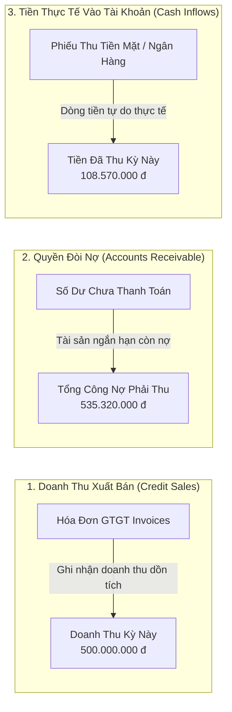
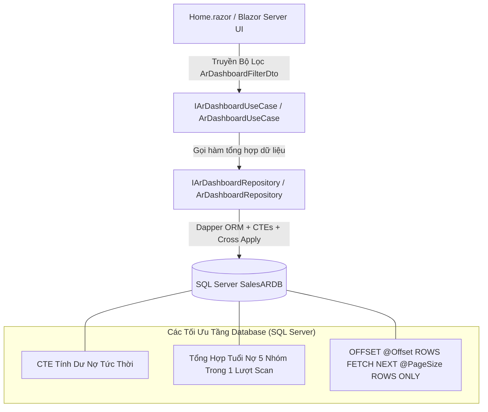

# TÀI LIỆU VẬN HÀNH & THIẾT KẾ: BÁO CÁO QUẢN TRỊ CÔNG NỢ & DỰ BÁO DÒNG TIỀN THU (PART 7/10)
## Đề tài 18: Bán hàng & Quản lý Công nợ Phải thu Khách hàng (Sales & Accounts Receivable)

---

## 1. Tổng Quan & Mục Tiêu

Hệ thống **Báo cáo quản trị công nợ & Dự báo thu tiền (AR Dashboard & Cash Collection Forecast)** được xây dựng nhằm cung cấp cho Ban Giám đốc và Kế toán trưởng góc nhìn toàn diện, trung thực và theo thời gian thực về chất lượng danh mục công nợ phải thu, tốc độ thu hồi tiền mặt và rủi ro thanh khoản của doanh nghiệp.

### Các nguyên tắc quản trị bắt buộc:
1. **Dữ liệu thật 100% (Zero Mock Data in Production)**: Toàn bộ chỉ số KPI, tuổi nợ, xu hướng và dòng tiền được tổng hợp và tính toán trực tiếp từ cơ sở dữ liệu SQL Server (`SalesARDB`).
2. **Nguyên tắc phân định 3 trụ cột tài chính độc lập**: Tuyệt đối không đánh đồng **Doanh thu bán chịu** (Credit Sales), **Khoản phải thu** (Accounts Receivable) và **Dòng tiền thực thu** (Cash Inflows).
3. **Phân tách bạch giữa Thực tế và Dự báo**: Các khoản tiền dự báo thu trong tương lai được trình bày tại phân hệ riêng biệt với tỷ lệ xác suất và phương pháp luận rõ ràng, không được cộng gộp vào dòng tiền thực tế đã thu.
4. **Hiệu năng & Tối ưu hóa**: Đẩy toàn bộ tác vụ tính toán nặng, tổng hợp nhóm tuổi nợ và phân trang (`OFFSET ... FETCH NEXT`) xuống hệ quản trị cơ sở dữ liệu SQL Server, không tải toàn bộ bản ghi thô về bộ nhớ máy chủ ứng dụng.

---

## 2. Danh Mục 10 Chỉ Số Quản Trị Cốt Lõi (AR KPIs)

| STT | Tên Chỉ Số | Tên Kỹ Thuật (DTO) | Công Thức / Cách Tính | Ý Nghĩa Quản Trị & Nghiệp Vụ |
| :---: | :--- | :--- | :--- | :--- |
| **1** | **Tổng công nợ phải thu** | `TotalArOutstanding` | $\sum (\text{TotalAmount} - \text{PaidAmount} - \text{AdjustedAmount})$ trên tất cả hóa đơn chưa tất toán | Tổng quy mô vốn của doanh nghiệp đang bị khách hàng chiếm dụng. |
| **2** | **Tổng công nợ quá hạn** | `TotalOverdueAr` | $\sum \text{RemainingAmount}$ của các hóa đơn có $\text{DueDate} < \text{AsOfDate}$ | Quy mô nợ đã trễ hạn thanh toán cam kết, phản ánh rủi ro tín dụng tiềm tàng. |
| **3** | **Tổng tiền đã thu trong kỳ** | `TotalCashCollectedInPeriod` | $\sum \text{Amount}$ từ bảng `dbo.Payments` có $\text{PaymentDate} \in [\text{FromDate}, \text{ToDate}]$ | Dòng tiền mặt thực tế đã chảy vào tài khoản ngân hàng / quỹ tiền mặt trong kỳ chọn. |
| **4** | **Số lượng & Giá trị hóa đơn chưa thanh toán** | `UnpaidInvoicesCount`, `UnpaidInvoicesAmount` | Đếm số lượng hóa đơn và tổng số dư còn nợ có $\text{RemainingAmount} > 0$ | Khối lượng chứng từ cần theo dõi đôn đốc và tổng dư nợ chờ thu hồi. |
| **5** | **Công nợ theo 5 nhóm tuổi nợ (Aging Buckets)** | `AgingBucketSummaryDto` | Phân nhóm theo số ngày quá hạn $\Delta = \text{DATEDIFF}(\text{day}, \text{DueDate}, \text{AsOfDate})$:<br>• **Trong hạn**: $\Delta \le 0$<br>• **Quá hạn 1-30 ngày**: $1 \le \Delta \le 30$<br>• **Quá hạn 31-60 ngày**: $31 \le \Delta \le 60$<br>• **Quá hạn 61-90 ngày**: $61 \le \Delta \le 90$<br>• **Quá hạn >90 ngày**: $\Delta > 90$ | Cơ sở trích lập dự phòng nợ phải thu khó đòi theo Thông tư 48/2019/TT-BTC và đánh giá sức khỏe danh mục nợ. |
| **6** | **Top khách hàng nợ nhiều nhất** | `TopDebtorCustomerDto` | Xếp hạng giảm dần theo $\sum \text{RemainingAmount}$ của từng khách hàng, tính kèm tỷ trọng $\%$ trên tổng nợ toàn hệ thống | Nhận diện mức độ tập trung tín dụng (Credit Concentration Risk) để áp dụng chính sách siết hạn mức kịp thời. |
| **7** | **Xu hướng thu tiền theo tháng** | `MonthlyCashFlowTrendDto` | Ma trận 6 tháng liên tiếp: Doanh số bán hàng (`Invoices.TotalAmount`) đối chiếu song song với Dòng tiền thực thu (`Payments.Amount`) | So sánh tốc độ tạo doanh thu với tốc độ thu hồi tiền mặt; nhận diện kịp thời khoảng trống thanh khoản (Liquidity Gap). |
| **8** | **Tỷ lệ nợ quá hạn (Giá trị & Số lượng)** | `OverdueValueRatio`, `OverdueCountRatio` | $\text{OverdueValueRatio} = \frac{\text{TotalOverdueAr}}{\text{TotalArOutstanding}} \times 100\%$<br>$\text{OverdueCountRatio} = \frac{\text{OverdueInvoicesCount}}{\text{UnpaidInvoicesCount}} \times 100\%$ | Đo lường tỷ lệ hao hụt kỷ luật thanh toán của khách hàng theo cả chiều sâu giá trị và diện rộng chứng từ. |
| **9** | **Số ngày thu tiền bình quân (DSO)** | `DsoDays`, `DsoExplanation` | $\text{DSO} = \frac{\text{TotalArOutstanding}}{\text{TotalCreditSalesInPeriod}} \times \text{DaysInPeriod}$ | Số ngày trung bình cần thiết để chuyển hóa doanh thu bán chịu thành tiền mặt.<br>*Xử lý trường hợp doanh số bằng 0*: Trả về `null` kèm cảnh báo minh bạch, tránh lỗi chia cho số 0. |
| **10**| **Dự báo dòng tiền thu hồi (Forecast)** | `CashCollectionForecastDto` | $\text{ExpectedCashInflow} = \text{NominalDueAmount} \times \text{Probability}$ | Dự phóng dòng tiền thu khả thi trong các khoảng thời gian tương lai dựa trên mô hình kỳ hạn và xác suất tổn thất. |

---

## 3. Ma Trận Phân Định 3 Trụ Cột Tài Chính (Bắt Buộc - Quy Tắc 2)

Hệ thống tuân thủ nghiêm ngặt chuẩn mực kế toán tài chính, tách bạch 3 khái niệm thường bị nhầm lẫn trong các hệ thống bán hàng thông thường:



### So sánh bản chất:
1. **Doanh thu (Revenue - `Invoices.TotalAmount`)**: Ghi nhận thời điểm phát sinh nghĩa vụ cung cấp hàng hóa/dịch vụ theo nguyên tắc dồn tích (*Accrual Basis*). Doanh thu cao **không đồng nghĩa** với việc doanh nghiệp đã có tiền mặt để trả nợ hoặc chi trả lương.
2. **Khoản phải thu (AR - `RemainingAmount`)**: Giá trị tài sản lưu động đại diện cho quyền đòi tiền của doanh nghiệp tại thời điểm đối soát (*AsOfDate*).
3. **Dòng tiền thực thu (Cash Inflow - `Payments.Amount`)**: Dòng tiền mặt thực tế đã chảy vào tài khoản ngân hàng hoặc quỹ tiền mặt theo nguyên tắc thực thu (*Cash Basis*). Đây là chỉ số duy nhất đảm bảo khả năng thanh toán tức thời của doanh nghiệp.

---

## 4. Phương Pháp Luận & Mô Hình Dự Báo Thu Tiền (Cash Collection Forecast)

### 4.1. Bảng Trọng Số Xác Suất Thu Hồi Theo Kỳ Hạn

Mô hình dự báo thu hồi tiền mặt được xây dựng dựa trên nguyên lý suy giảm giá trị theo thời gian (*Aging Roll-Rate & Due-Date Probability Model*):

| Mã Phân Kỳ (`PeriodKey`) | Khoảng Thời Gian Phân Tích | Trọng Số Xác Suất Thu Hồi | Mức Độ Tin Cậy | Cơ Sở & Giả Định Tính Toán |
| :--- | :--- | :---: | :---: | :--- |
| **`NEXT_7_DAYS`** | Hóa đơn đáo hạn trong 7 ngày tới | **90%** (0.90) | **Cao** | Hóa đơn mới, trong kỳ hạn chuẩn, khách hàng có thói quen thanh toán đúng hẹn theo cam kết hợp đồng. |
| **`NEXT_8_TO_15_DAYS`** | Hóa đơn đáo hạn từ ngày 8 đến ngày 15 | **85%** (0.85) | **Cao** | Hóa đơn sắp đến hạn giữa kỳ, rủi ro trễ hạn thấp đối với nhóm khách hàng định kỳ. |
| **`NEXT_16_TO_30_DAYS`** | Hóa đơn đáo hạn từ ngày 16 đến ngày 30 | **80%** (0.80) | **Trung bình** | Kỳ hạn cuối tháng, có thể chịu ảnh hưởng nhẹ bởi chu kỳ phê duyệt dòng tiền nội bộ của khách hàng. |
| **`OVERDUE_RECOVERABLE`**| Hóa đơn quá hạn từ 1 đến 30 ngày | **70%** (0.70) | **Trung bình** | Nợ quá hạn ngắn hạn, khả năng thu hồi đạt 70% sau khi áp dụng quy trình nhắc nợ đợt 1 và đợt 2. |
| **`OVERDUE_BAD_DEBT`** | Hóa đơn quá hạn trên 30 ngày | **20%** (0.20) | **Thận trọng** | Nợ quá hạn dài ngày, khả năng thu hồi thấp; doanh nghiệp cần áp dụng chế tài thu nợ đặc biệt hoặc pháp lý. |

### 4.2. Tuyên Bố Miễn Trừ & Quy Tắc Giám Sát Dự Báo (Rule 4 & Rule 5)
> [!IMPORTANT]
> **Tuyên bố minh bạch**: Con số dự báo $\text{ExpectedCashInflow}$ được ước lượng bằng phương pháp thống kê kỳ hạn và tỷ lệ thu hồi kỳ vọng. Con số này **hoàn toàn độc lập** với dòng tiền thực thu lịch sử và không cấu thành cam kết dòng tiền chắc chắn 100%. Dự báo chỉ có giá trị tham khảo trong việc lập kế hoạch thanh khoản ngắn hạn và điều chuyển dòng vốn lưu động.

---

## 5. Kiến Trúc Kỹ Thuật (Clean Architecture & Query Optimization)



### Điểm nhấn thiết kế kỹ thuật:
1. **Phép tính Dư nợ thời gian thực (`RemainingAmount`)**:
   Do hóa đơn có thể được thanh toán từng phần qua nhiều đợt (`PaymentAllocations`) và có thể có điều chỉnh giảm trừ công nợ (`DebtAdjustments`), truy vấn sử dụng cấu trúc `CROSS APPLY`:
   ```sql
   CROSS APPLY (
       SELECT 
           ISNULL((SELECT SUM(AllocatedAmount) FROM dbo.PaymentAllocations WHERE InvoiceId = i.Id), 0) AS PaidAmount,
           ISNULL((SELECT SUM(Amount) FROM dbo.DebtAdjustments WHERE InvoiceId = i.Id), 0) AS AdjustedAmount
   ) alloc
   CROSS APPLY (
       SELECT (i.TotalAmount - alloc.PaidAmount - alloc.AdjustedAmount) AS RemainingAmount
   ) inv
   ```
2. **Tổng hợp 5 nhóm tuổi nợ trong duy nhất 1 lần quét bảng**:
   Thay vì chạy 5 câu query đếm riêng rẽ gây nghẽn I/O, hệ thống sử dụng kỹ thuật `SUM(CASE WHEN ... THEN ... ELSE 0 END)` gom toàn bộ 5 nhóm tuổi nợ vào 1 câu SQL duy nhất.
3. **Phân trang an toàn phía Server (Server-Side Pagination)**:
   Bảng chi tiết công nợ hỗ trợ tìm kiếm theo khách hàng, trạng thái (`Unpaid`, `PartiallyPaid`, `Overdue`, `InDispute`), và tuổi nợ. Dữ liệu chỉ tải đúng số lượng `@PageSize` bản ghi qua cơ chế chuẩn `OFFSET ... FETCH NEXT` của SQL Server.

---

## 6. Bộ Kiểm Thử Đơn Vị & Kiểm Định Nghiệp Vụ (Unit Tests)

Bộ kiểm thử đơn vị được cài đặt tại [ArDashboardAndForecastTests.cs](file:///d:/L%E1%BA%ADp%20tr%C3%ACnh%20web/B%C3%80I%20THI/SalesAR.UnitTests/ArDashboardAndForecastTests.cs) với **100% tỷ lệ pass (63/63 tests)**:

| Tên Test Case | Mục Đích Kiểm Thử | Kết Quả Thực Tế |
| :--- | :--- | :---: |
| `ExecuteAsync_ValidFilter_CalculatesDsoCorrectly` | Kiểm tra công thức $DSO = \frac{\text{AR}}{\text{Sales}} \times \text{Days}$ cho ra kết quả chính xác (15.0 ngày) | **PASSED** |
| `ExecuteAsync_ZeroCreditSales_HandlesDsoWithoutDivisionByZero` | Kiểm tra ngoại lệ doanh thu = 0: trả về null và giải thích rõ ràng thay vì crash hệ thống | **PASSED** |
| `ExecuteAsync_ReversedDateRange_AutomaticallyNormalizesDates` | Kiểm tra tự động hoán vị FromDate và ToDate nếu người dùng chọn ngược | **PASSED** |
| `ExecuteAsync_TopDebtors_CalculatesDebtSharePercentageCorrectly` | Kiểm tra tính toán tỷ trọng nợ từng khách hàng so với tổng nợ toàn hệ thống | **PASSED** |
| `ExecuteAsync_ZeroSystemDebt_TopDebtorsShareIsZero` | Kiểm tra an toàn khi hệ thống sạch nợ ($AR = 0$), tỷ trọng về 0% | **PASSED** |
| `ArKpiSummaryDto_CalculatesOverdueRatiosAccurately` | Kiểm tra tỷ lệ nợ quá hạn theo giá trị (30.00%) và số lượng (30.00%) | **PASSED** |
| `AgingBucketSummaryDto_CalculatesTotalsAndPercentagesCorrectly` | Kiểm tra tính toán tổng 5 nhóm tuổi nợ và tỷ lệ % phân bổ | **PASSED** |
| `CashCollectionForecastDto_CalculatesExpectedCashInflowWeightedProbability` | Kiểm tra tính tiền kỳ vọng bằng tích số giữa Giá trị danh nghĩa và Xác suất | **PASSED** |
| `ArDashboardFilterDto_OffsetCalculation_IsSafeAndCorrect` | Kiểm tra logic tính Offset cho SQL phân trang, xử lý an toàn trang âm hoặc trang 0 | **PASSED** |
| `ExecuteAsync_PropagatesCustomerAndAgingFiltersProperly` | Kiểm tra tính toàn vẹn của tham số bộ lọc khi truyền xuống Repository | **PASSED** |

---

## 7. Hướng Dẫn Vận Hành & Khảo Sát Giao Diện

1. **Khởi chạy ứng dụng**:
   ```bash
   dotnet run --project SalesAR.Web/SalesAR.Web.csproj --launch-profile https
   ```
2. **Truy cập Dashboard**: Mở trình duyệt tại đường dẫn `https://localhost:7167` hoặc `https://localhost:7167/dashboard`.
3. **Thao tác nghiệp vụ trên giao diện**:
   - **Thanh lọc thông minh (Filter Bar)**: Chọn mốc ngày đối soát (*AsOfDate*), khoảng thời gian xem doanh thu/dòng tiền (*Từ ngày - Đến ngày*), chọn Khách hàng cụ thể, bấm **"Áp Dụng Bộ Lọc"**.
   - **4 Thẻ KPI Tài Chính**: Quan sát nhanh Tổng nợ phải thu, Nợ quá hạn, Dòng tiền thực thu trong kỳ, và Chỉ số DSO kèm thuyết minh.
   - **Banner Phân Định**: Đối chiếu Doanh thu bán chịu vs Thực thu tiền mặt vs Dư nợ hiện hành.
   - **Bảng 5 Nhóm Tuổi Nợ**: Theo dõi giá trị, số hóa đơn và tỷ lệ % của từng phân nhóm (Trong hạn, 1-30, 31-60, 61-90, >90 ngày).
   - **Bảng Dự Báo Thu Tiền**: Xem xét dòng tiền kỳ vọng 7 ngày, 15 ngày, 30 ngày và nợ quá hạn có khả năng thu hồi kèm mức độ tin cậy.
   - **Biểu Đồ Xu Hướng 6 Tháng**: Đánh giá độ chênh lệch giữa xuất bán và dòng tiền thực thu qua từng tháng.
   - **Bảng Chi Tiết Hóa Đơn & Phân Trang**: Lọc hóa đơn theo tuổi nợ hoặc trạng thái nợ tranh chấp, chuyển trang tức thời.
