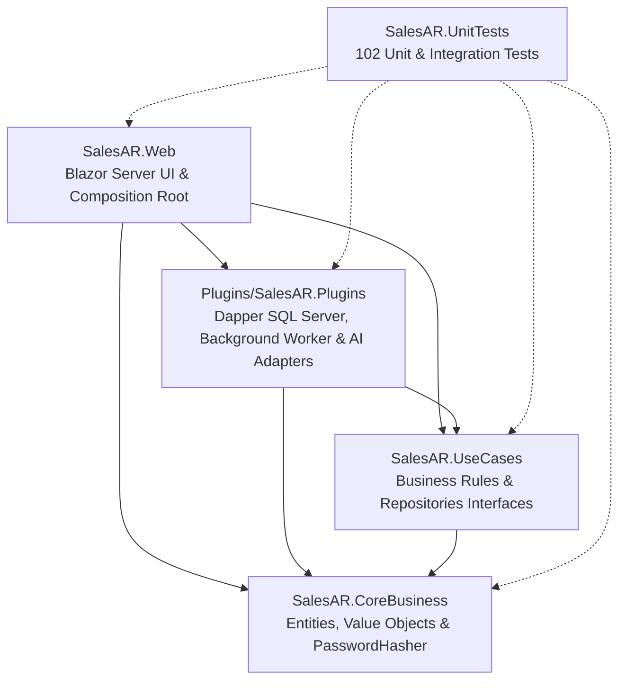
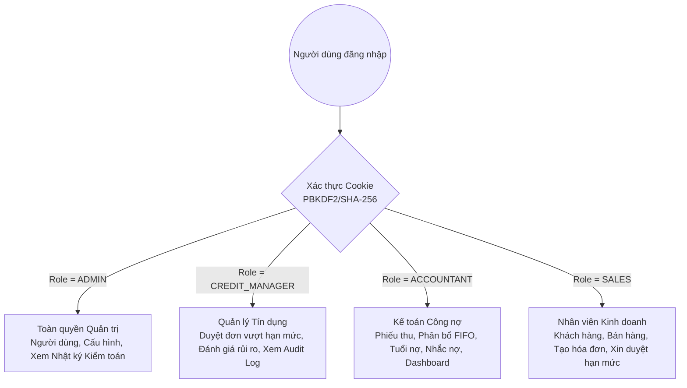

# 🏛 KIẾN TRÚC HỆ THỐNG CHUẨN MỰC (CLEAN ARCHITECTURE FOUNDATION)
## ĐỒ ÁN MÔN HỌC: LẬP TRÌNH WEB
### ĐỀ TÀI SỐ 18: BÁN HÀNG & CÔNG NỢ KHÁCH HÀNG (SALES & ACCOUNTS RECEIVABLE)

> **Mã quy trình**: `PART 10/10 — FINAL ARCHITECTURAL SPECIFICATION`  
> **Phiên bản kiến trúc**: 3.0 (Clean Architecture, Domain-Driven Design & Plugin Pattern)  
> **Nền tảng**: .NET 8.0 LTS • C# 12 • ASP.NET Core Blazor Server (InteractiveServer) • Microsoft SQL Server • Dapper  
> **Trạng thái**: Đã chuẩn hóa toàn diện 10/10 Parts • 100% Component gọi UseCase • 0 Lỗi biên dịch • 102/102 Tests Passed

---

## 1. MÔ HÌNH KIẾN TRÚC 4 TẦNG & TRÁCH NHIỆM

Hệ thống được tổ chức thành 4 project cốt lõi theo mô hình **Onion / Clean Architecture** kết hợp **Plugin Architecture**, cộng thêm 1 project kiểm thử tự động:

```
Solution: SalesAR.sln
│
├── 🟢 SalesAR.CoreBusiness/       [TẦNG 1: DOMAIN ENTITIES & VALUE OBJECTS]
│   └── Trách nhiệm: Chứa các thực thể trung tâm, hằng số, Enum và công cụ mã hóa bảo mật.
│       Độc lập tuyệt đối, 0 ProjectReference và 0 PackageReference ngoài.
│       File: Customer.cs, Invoice.cs, InvoiceLine.cs, Payment.cs, PaymentAllocation.cs,
│             CreditLimitRequest.cs, CreditLimitApproval.cs, ReminderRule.cs, ReminderLog.cs,
│             DebtAdjustment.cs, AuditLog.cs, User.cs, Role.cs, PasswordHasher.cs.
│
├── 🔵 SalesAR.UseCases/           [TẦNG 2: APPLICATION BUSINESS RULES & CONTRACTS]
│   └── Trách nhiệm: Điều phối toàn bộ quy trình nghiệp vụ (Kiểm soát hạn mức tín dụng,
│       phân bổ thanh toán FIFO, tính toán tuổi nợ Aging, quy trình phê duyệt hạn mức,
│       bộ quy tắc nhắc nợ tự động, tính toán 10 KPI Dashboard, AI Copilot Grounding).
│       Chứa thư mục PluginInterfaces/ định nghĩa hợp đồng trừu tượng cho Repository.
│       Chỉ phụ thuộc DUY NHẤT SalesAR.CoreBusiness.
│
├── 🟡 Plugins/SalesAR.Plugins/    [TẦNG 3: INFRASTRUCTURE, DATA ACCESS & EXTERNAL ADAPTERS]
│   └── Trách nhiệm: Hiện thực hóa các interface Repository bằng Dapper và Microsoft SQL Server.
│       Quản lý kết nối SqlConnectionFactory, Transaction cấn trừ nợ nguyên khối (ACID).
│       Dịch vụ nền nhắc nợ tự động (BackgroundReminderJobScheduler kế thừa IHostedService).
│       Adapter AI (GeminiAiProvider & LocalHeuristicAiProvider fallback).
│       Chỉ tham chiếu SalesAR.CoreBusiness và SalesAR.UseCases.
│
├── 🟣 SalesAR.Web/                [TẦNG 4: PRESENTATION & COMPOSITION ROOT]
│   └── Trách nhiệm: Giao diện người dùng Blazor Server, Cookie Authentication State,
│       Minimal API endpoints, xuất file báo cáo Excel (ClosedXML) và PDF (QuestPDF).
│       Đóng vai trò Composition Root: cấu hình Dependency Injection toàn bộ ứng dụng.
│       Mọi trang Razor (.razor) CHỈ inject UseCases hoặc Abstractions, KHÔNG inject Repository.
│
└── ⚪ SalesAR.UnitTests/          [TẦNG KIỂM THỬ: XUNIT AUTOMATED TESTING & DB INTEGRATION]
    └── Trách nhiệm: 102 bài test tự động bao phủ 15 kịch bản nghiệp vụ bắt buộc,
        kiểm thử tích hợp giao dịch ACID và Concurrency locking trực tiếp trên SQL Server.
```

---

## 2. MA TRẬN PHỤ THUỘC (DEPENDENCY MATRIX) & TUÂN THỦ NGUYÊN TẮC KIẾN TRÚC

### 2.1. Bảng đối chiếu quy tắc phụ thuộc giữa các file `.csproj`

| Project | File `.csproj` | ProjectReference Thực Tế | Vi phạm Dependency? | Tuân thủ Clean Architecture |
| :--- | :--- | :--- | :---: | :---: |
| **`SalesAR.CoreBusiness`** | `SalesAR.CoreBusiness.csproj` | *(0 reference)* | **Không** | **Đạt tuyệt đối** (Nhân Domain độc lập) |
| **`SalesAR.UseCases`** | `SalesAR.UseCases.csproj` | `..\SalesAR.CoreBusiness\` | **Không** | **Đạt tuyệt đối** (Chỉ phụ thuộc Domain) |
| **`SalesAR.Plugins`** | `SalesAR.Plugins.csproj` | `..\..\SalesAR.CoreBusiness\`<br>`..\..\SalesAR.UseCases\` | **Không** | **Đạt tuyệt đối** (Adapter hướng vào trong) |
| **`SalesAR.Web`** | `SalesAR.Web.csproj` | `..\SalesAR.CoreBusiness\`<br>`..\SalesAR.UseCases\`<br>`..\Plugins\SalesAR.Plugins\` | **Không** | **Đạt tuyệt đối** (Composition Root) |
| **`SalesAR.UnitTests`** | `SalesAR.UnitTests.csproj` | `..\SalesAR.CoreBusiness\`<br>`..\SalesAR.UseCases\`<br>`..\Plugins\SalesAR.Plugins\`<br>`..\SalesAR.Web\` | **Không** | **Đạt tuyệt đối** (Test Runner đa tầng) |

### 2.2. Biểu đồ luồng phụ thuộc (Dependency Graph)



---

## 3. DANH MỤC USECASES & REPOSITORY INTERFACES

### 3.1. Danh mục UseCases (Tầng Application)

| Nhóm Nghiệp Vụ | UseCase Class | Trách nhiệm chính |
| :--- | :--- | :--- |
| **Bán hàng & Hóa đơn** | `CreateInvoiceUseCase` | Kiểm tra hạn mức khả dụng, sinh mã hóa đơn, ghi nhận nợ |
| | `ViewInvoiceDetailsUseCase` | Đọc chi tiết hóa đơn, các dòng sản phẩm và lịch sử phân bổ |
| **Thanh toán & Cấn trừ** | `AllocatePaymentUseCase` | Thuật toán phân bổ thanh toán tự động theo thứ tự FIFO |
| | `RecordPaymentUseCase` | Ghi nhận phiếu thu và kích hoạt phân bổ nợ trong Transaction |
| | `ReallocatePaymentUseCase` | Điều chỉnh lại phân bổ thanh toán khi có thay đổi nghiệp vụ |
| **Tuổi nợ & Báo cáo** | `GenerateAgingReportUseCase` | Phân tổ công nợ theo 4 nhóm ngày (0-30, 31-60, 61-90, >90) |
| | `ExportAgingReportUseCase` | Xuất bảng kê tuổi nợ ra file Excel (.xlsx) và PDF (.pdf) |
| **Phê duyệt hạn mức** | `CreateCreditLimitRequestUseCase` | Nhân viên kinh doanh nộp đơn xin duyệt vượt hạn mức |
| | `ApproveCreditLimitRequestUseCase` | Quản lý tín dụng duyệt đơn (Kiểm tra SoD, khóa bi quan) |
| | `RejectCreditLimitRequestUseCase` | Từ chối yêu cầu vượt hạn mức kèm lý do |
| | `CancelCreditLimitRequestUseCase` | Hủy yêu cầu khi đơn hàng bị hủy |
| **Tự động nhắc nợ** | `EvaluateReminderRuleUseCase` | Đánh giá điều kiện đến hạn và quá hạn của hóa đơn |
| | `ProcessPendingRemindersUseCase` | Background Worker gửi email nhắc nợ, xử lý Cooldown & Retry |
| **Dashboard & Dự báo** | `GetArDashboardKpiUseCase` | Tính toán 10 chỉ số KPI tài chính trọng yếu và DSO |
| | `GetCashCollectionForecastUseCase`| Mô hình dự báo dòng tiền vào theo xác suất lịch sử |
| **Trợ lý AI** | `SummarizeCustomerArUseCase` | Tổng hợp tình hình công nợ, phân tách GroundTruth & Narrative |
| | `AssessCustomerCreditRiskUseCase` | Chấm điểm rủi ro tín dụng v1.0 theo Rule-based minh bạch |
| | `GenerateReminderDraftUseCase` | Soạn thảo bản nháp thư nhắc nợ theo 3 sắc thái cảm xúc |
| **Bảo mật & Kiểm toán** | `LoginUseCase` | Xác thực đăng nhập bằng PBKDF2/SHA-256 + Salt |
| | `GetPagedAuditLogsUseCase` | Phân trang, tìm kiếm và so sánh Diff JSON lịch sử kiểm toán |

### 3.2. Danh mục Repository Interfaces (Thư mục `SalesAR.UseCases/PluginInterfaces/`)

- `ICustomerRepository`: Quản lý khách hàng, hạn mức tín dụng và số dư nợ hiện tại.
- `IProductRepository`: Quản lý danh mục hàng hóa, đơn giá và tồn kho.
- `IInvoiceRepository`: Quản lý hóa đơn, chi tiết dòng hàng và cập nhật trạng thái.
- `IPaymentRepository`: Quản lý phiếu thu, phân bổ thanh toán và điều chỉnh phân bổ.
- `IAgingReportRepository`: Truy vấn dữ liệu phân tích tuổi nợ khách hàng.
- `ICreditLimitRequestRepository`: Quản lý vòng đời đơn duyệt hạn mức tín dụng.
- `IReminderRepository`: Quản lý luật nhắc nợ, nhật ký gửi, hàng đợi retry và tranh chấp.
- `IArDashboardRepository`: Truy vấn tổng hợp KPI và xu hướng thu tiền.
- `IAuditLogRepository`: Truy vấn phân trang nhật ký kiểm toán hệ thống.
- `ICreditRiskAssessmentRepository`: Lưu trữ lịch sử đánh giá rủi ro tín dụng.
- `IUserRepository`, `IRoleRepository`: Quản lý tài khoản người dùng và vai trò bảo mật.

---

## 4. QUẢN TRỊ VÒNG ĐỜI DỊCH VỤ (DEPENDENCY INJECTION LIFETIMES)

Được cấu hình chuẩn mực tại `SalesAR.Web/Program.cs`:

| Phân loại | Interface / Service | Triển khai | Lifetime | Lý do lựa chọn |
| :--- | :--- | :--- | :---: | :--- |
| **Cơ sở dữ liệu** | `ISqlConnectionFactory` | `SqlConnectionFactory` | `Singleton` | Connection string và Factory thread-safe, không chứa state tạm. |
| **Hạ tầng bảo mật** | `IPasswordHasher` | `PasswordHasher` | `Singleton` | Thuật toán băm PBKDF2 là pure logic, phi trạng thái. |
| **Dịch vụ nền** | `IHostedService` | `BackgroundReminderJobScheduler` | `Singleton` | Chạy nền định kỳ xuyên suốt vòng đời ứng dụng. |
| **Trợ lý AI** | `IAiProvider` | `GeminiAiProvider` | `Scoped` | Tận dụng HttpClientFactory và Scoped Configuration. |
| | `LocalHeuristicAiProvider` | `LocalHeuristicAiProvider` | `Singleton` | Rule Engine nội bộ không trạng thái. |
| **Repositories** | `ICustomerRepository`, `IInvoiceRepository`... | Dapper Repositories | `Scoped` | Gắn liền với vòng đời một phiên kết nối / Circuit của Blazor. |
| **UseCases** | `CreateInvoiceUseCase`, `RecordPaymentUseCase`... | Concrete UseCases | `Scoped` | Mỗi tương tác người dùng tạo UseCase với các Repository phụ thuộc. |
| **Xác thực** | `AuthenticationStateProvider` | `CustomAuthenticationStateProvider` | `Scoped` | Lưu giữ danh tính phiên đăng nhập riêng biệt cho từng người dùng. |

---

## 5. THIẾT KẾ BẢO MẬT & PHÂN QUYỀN RBAC (4 ROLES)

Hệ thống triển khai mô hình kiểm soát truy cập phân tầng (Role-Based Access Control) với 4 nhóm vai trò được cấp phát quyền rõ ràng:



- **Server-Side Enforcement**: Mọi hành động nhạy cảm đều được bảo vệ tại UseCase. Ví dụ `ApproveCreditLimitRequestUseCase` kiểm tra trực tiếp:
  ```csharp
  if (approverRole != "CREDIT_MANAGER" && approverRole != "ADMIN")
      throw new UnauthorizedAccessException("Chỉ CREDIT_MANAGER hoặc ADMIN mới có quyền duyệt đơn này.");
  ```
- **Segregation of Duties (SoD)**: Người yêu cầu đơn tín dụng không thể tự duyệt đơn của chính mình:
  ```csharp
  if (string.Equals(request.RequestedBy, approverUsername, StringComparison.OrdinalIgnoreCase))
      throw new InvalidOperationException("Vi phạm Segregation of Duties: Người tạo đơn không được phép tự phê duyệt.");
  ```
- **Cookie Security**: Cookie xác thực được bảo vệ bằng các cờ `HttpOnly = true`, `SameSite = Strict`, `SlidingExpiration = true`, `ExpireTimeSpan = 8 giờ`.
