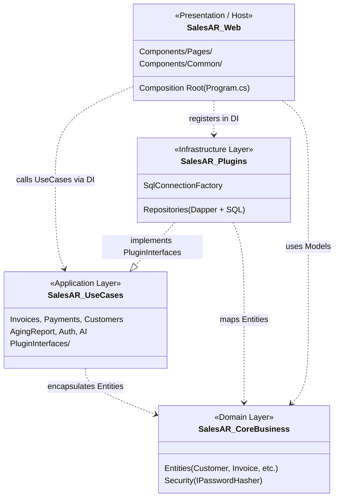

# 🏛 KIẾN TRÚC HỆ THỐNG CHUẨN MỰC (CLEAN ARCHITECTURE FOUNDATION)
## ĐỒ ÁN: 18. BÁN HÀNG & CÔNG NỢ KHÁCH HÀNG (SALES & ACCOUNTS RECEIVABLE)

> **Mã quy trình**: `PART 2/10 — CLEAN ARCHITECTURE FOUNDATION`  
> **Phiên bản kiến trúc**: 2.0 (Clean Architecture & Plugin Pattern)  
> **Nền tảng**: .NET 8.0 LTS • C# 12 • ASP.NET Core Blazor Server (InteractiveServer) • Microsoft SQL Server  
> **Trạng thái**: Đã chuẩn hóa toàn diện, 100% Component gọi UseCase, 0 lỗi biên dịch, 20/20 Test Passed.

---

## 1. MÔ HÌNH KIẾN TRÚC 4 TẦNG & TRÁCH NHIỆM

Hệ thống được tổ chức thành 4 project cốt lõi theo mô hình **Onion / Clean Architecture** kết hợp **Plugin Architecture**, cộng thêm 1 project kiểm thử tự động:

```
Solution: SalesAR.sln
│
├── 🟢 SalesAR.CoreBusiness/       [TẦNG 1: DOMAIN ENTITIES & SECURITY CONCEPTS]
│   └── Trách nhiệm: Chứa các thực thể nghiệp vụ trung tâm và quy chuẩn băm mật khẩu.
│       Độc lập tuyệt đối, không tham chiếu bất kỳ project hay thư viện bên ngoài nào.
│
├── 🔵 SalesAR.UseCases/           [TẦNG 2: APPLICATION BUSINESS RULES & CONTRACTS]
│   └── Trách nhiệm: Điều phối toàn bộ luồng nghiệp vụ (Hạn mức nợ, Phân bổ FIFO, Tuổi nợ, Xác thực).
│       Chứa thư mục PluginInterfaces/ định nghĩa các hợp đồng Repository trừu tượng.
│       Chỉ tham chiếu duy nhất SalesAR.CoreBusiness.
│
├── 🟡 Plugins/SalesAR.Plugins/    [TẦNG 3: INFRASTRUCTURE & DATA ACCESS ADAPTERS]
│   └── Trách nhiệm: Hiện thực hóa các interface Repository bằng Dapper và ADO.NET SQL Server.
│       Quản lý kết nối CSDL, Transaction cấn trừ nợ và xuất nhập kho.
│       Tham chiếu SalesAR.CoreBusiness và SalesAR.UseCases.
│
├── 🟣 SalesAR.Web/                [TẦNG 4: PRESENTATION & COMPOSITION ROOT]
│   └── Trách nhiệm: Giao diện người dùng Blazor Server, Cookie Authentication, Minimal APIs.
│       Đóng vai trò Composition Root để đăng ký Dependency Injection cho toàn hệ thống.
│       Giao diện (.razor) CHỈ giao tiếp với hệ thống thông qua UseCases, KHÔNG inject Repository.
│
└── ⚪ SalesAR.UnitTests/          [TẦNG KIỂM THỬ: XUNIT AUTOMATED TESTING]
    └── Trách nhiệm: Kiểm thử độc lập từng luật nghiệp vụ (Credit Limit, FIFO, Password Hasher, QuestPDF).
```

---

## 2. MA TRẬN PHỤ THUỘC (DEPENDENCY MATRIX) & XÁC THỰC

### 2.1. Bảng đối chiếu quy tắc phụ thuộc giữa các file `.csproj`

| Project | File `.csproj` | ProjectReference Thực Tế | Vi phạm Dependency? | Tuân thủ Clean Architecture |
| :--- | :--- | :--- | :---: | :---: |
| **`SalesAR.CoreBusiness`** | `SalesAR.CoreBusiness.csproj` | *(0 reference)* | **Không** | **Đạt tuyệt đối** (Nhân Domain độc lập) |
| **`SalesAR.UseCases`** | `SalesAR.UseCases.csproj` | `..\SalesAR.CoreBusiness\` | **Không** | **Đạt tuyệt đối** (Chỉ phụ thuộc Domain) |
| **`SalesAR.Plugins`** | `SalesAR.Plugins.csproj` | `..\..\SalesAR.CoreBusiness\`<br>`..\..\SalesAR.UseCases\` | **Không** | **Đạt tuyệt đối** (Adapter hướng vào trong) |
| **`SalesAR.Web`** | `SalesAR.Web.csproj` | `..\SalesAR.CoreBusiness\`<br>`..\SalesAR.UseCases\`<br>`..\Plugins\SalesAR.Plugins\` | **Không** | **Đạt tuyệt đối** (Composition Root) |
| **`SalesAR.UnitTests`** | `SalesAR.UnitTests.csproj` | `..\SalesAR.CoreBusiness\`<br>`..\SalesAR.UseCases\`<br>`..\SalesAR.Web\` | **Không** | **Đạt** (Kiểm thử UseCase & Services) |

### 2.2. Biểu đồ luồng phụ thuộc (Dependency Graph)



---

## 3. DANH BẠ DEPENDENCY INJECTION (DI CONTAINER REGISTRATION)

Được cấu hình tập trung tại Composition Root (`SalesAR.Web/Program.cs`):

### 3.1. Phân loại Lifetime chuẩn mực

| Nhóm dịch vụ | Interface | Lớp triển khai (Implementation) | Lifetime | Lý do lựa chọn Lifetime |
| :--- | :--- | :--- | :---: | :--- |
| **Cơ sở dữ liệu** | `ISqlConnectionFactory` | `SqlConnectionFactory` | `Singleton` | Connection string và Factory là thread-safe, không chứa trạng thái tạm. |
| **Bảo mật** | `IPasswordHasher` | `PasswordHasher` | `Singleton` | Không có state, mã hóa thuật toán PBKDF2/SHA-256 dùng chung toàn ứng dụng. |
| **Xác thực** | `AuthenticationStateProvider` | `CustomAuthenticationStateProvider` | `Scoped` | Trạng thái đăng nhập gắn liền theo từng phiên kết nối SignalR của người dùng. |
| **Hạ tầng Repositories** | `ICustomerRepository` | `CustomerRepository` | `Scoped` | Mở kết nối SQL và giải phóng theo từng yêu cầu / vòng đời Circuit. |
| | `IProductRepository` | `ProductRepository` | `Scoped` | Tương tự |
| | `IInvoiceRepository` | `InvoiceRepository` | `Scoped` | Tương tự |
| | `IPaymentRepository` | `PaymentRepository` | `Scoped` | Tương tự |
| | `IAgingReportRepository` | `AgingReportRepository` | `Scoped` | Tương tự |
| | `IUserRepository` | `UserRepository` | `Scoped` | Tương tự |
| | `IRoleRepository` | `RoleRepository` | `Scoped` | Tương tự |
| **Khách hàng UseCases** | `IViewCustomersUseCase`<br>`IViewCustomerByIdUseCase`<br>`IAddCustomerUseCase`<br>`IEditCustomerUseCase`<br>`IDeleteCustomerUseCase`<br>`IGetCustomerDebtUseCase` | `ViewCustomersUseCase`<br>`ViewCustomerByIdUseCase`<br>`AddCustomerUseCase`<br>`EditCustomerUseCase`<br>`DeleteCustomerUseCase`<br>`GetCustomerDebtUseCase` | `Scoped` | Vòng đời phụ thuộc các Repository đã inject vào constructor. |
| **Sản phẩm UseCases** | `IViewProductsUseCase`<br>`IViewProductByIdUseCase`<br>`IAddProductUseCase`<br>`IEditProductUseCase`<br>`IDeleteProductUseCase` | `ViewProductsUseCase`<br>`ViewProductByIdUseCase`<br>`AddProductUseCase`<br>`EditProductUseCase`<br>`DeleteProductUseCase` | `Scoped` | Quản lý danh mục hàng hóa |
| **Hóa đơn UseCases** | `IViewInvoicesUseCase`<br>`ICreateInvoiceUseCase` | `ViewInvoicesUseCase`<br>`CreateInvoiceUseCase` | `Scoped` | Kiểm soát hạn mức tín dụng và tạo hóa đơn bán hàng |
| **Thanh toán UseCases** | `IAllocatePaymentUseCase`<br>`IRecordPaymentUseCase`<br>`IProcessPaymentUseCase`<br>`IViewPaymentsUseCase` | `AllocatePaymentUseCase`<br>`RecordPaymentUseCase`<br>`ProcessPaymentUseCase`<br>`ViewPaymentsUseCase` | `Scoped` | Cấn trừ nợ FIFO và lưu trữ giao dịch |
| **Báo cáo Tuổi nợ** | `IGetAgingReportUseCase`<br>`IViewAgingReportUseCase`<br>`IAgingReportExporter` | `GetAgingReportUseCase`<br>`ViewAgingReportUseCase`<br>`AgingReportExporter` | `Scoped` | Phân tổ kỳ hạn nợ & xuất file Excel / PDF |
| **Trợ lý AI** | `IDebtReminderAiService` | `DebtReminderAiService` | `Scoped` | Sinh dự thảo nhắc nợ tự động theo từng khách hàng |
| **Quản trị người dùng** | `ILoginUseCase`<br>`IViewUsersUseCase`<br>`ICreateUserUseCase`<br>`IToggleUserStatusUseCase`<br>`IViewRolesUseCase` | `LoginUseCase`<br>`ViewUsersUseCase`<br>`CreateUserUseCase`<br>`ToggleUserStatusUseCase`<br>`ViewRolesUseCase` | `Scoped` | Phân quyền và tài khoản RBAC |

---

## 4. CHUẨN HÓA GIAO TIẾP TẦNG TRÌNH DIỄN (ZERO-REPOSITORY IN RAZOR)

### 4.1. Vấn đề kiến trúc được khắc phục trong Part 2
Trong quá trình Audit (Part 1), phát hiện 4 trang `.razor` từng inject trực tiếp Interface Repository:
- `CreatePayment.razor`: inject `IInvoiceRepository`
- `CustomerDetail.razor`: inject `IInvoiceRepository` & `IPaymentRepository`
- `InvoiceDetail.razor`: inject `IPaymentRepository`
- `DebtSummary.razor`: inject `IInvoiceRepository`
- `Payments.razor`: inject `IPaymentRepository` (không dùng)

### 4.2. Giải pháp tái cấu trúc triệt để
1. Mở rộng `IViewInvoicesUseCase` và `ViewInvoicesUseCase` với 2 phương thức:
   - `Task<IEnumerable<Invoice>> GetInvoicesByCustomerAsync(int customerId);`
   - `Task<IEnumerable<InvoiceOutstandingDto>> GetOutstandingInvoicesByCustomerAsync(int customerId);`
2. Mở rộng `IViewPaymentsUseCase` và `ViewPaymentsUseCase` với 2 phương thức:
   - `Task<IEnumerable<Payment>> GetPaymentsByCustomerAsync(int customerId);`
   - `Task<IEnumerable<PaymentAllocation>> GetAllocationsByCustomerAsync(int customerId);`
3. Cập nhật toàn bộ các trang `.razor` trên:
   - Chuyển toàn bộ `@inject I...Repository` sang `@inject IViewInvoicesUseCase` và `@inject IViewPaymentsUseCase`.
   - Xóa bỏ `@inject IPaymentRepository` thừa tại `Payments.razor`.

👉 **KẾT QUẢ KIỂM CHỨNG**: Tìm kiếm toàn bộ thư mục `SalesAR.Web/Components` xác nhận **0 kết quả chứa từ khóa Repository**. Toàn bộ 100% giao diện Blazor hiện nay giao tiếp độc quyền thông qua UseCases!

---

## 5. DỌN DẸP & HỢP NHẤT USECASE THANH TOÁN

- **Vấn đề**: `ProcessPaymentUseCase` cũ chứa đoạn mã gán cứng `alreadyAllocated = 0`, gây nguy cơ phân bổ sai số dư đối với các hóa đơn thanh toán nhiều đợt (`PartiallyPaid`).
- **Giải pháp**: Tái cấu trúc `ProcessPaymentUseCase` thành dạng **Decorator / Delegation Pattern**, chuyển tiếp toàn bộ cuộc gọi sang `IRecordPaymentUseCase.ExecuteAsync(payment)`.
- **Lợi ích**: Bảo toàn tương thích hợp đồng `IProcessPaymentUseCase` trong DI, đồng thời loại bỏ triệt để đoạn mã lỗi tiềm ẩn.

---

## 6. BẰNG CHỨNG KIỂM TRA THỰC TẾ (VERIFIABLE EVIDENCE)

### 6.1. Kiểm tra Biên dịch Solution (`dotnet build`)
```text
Build succeeded.
    0 Warning(s)
    0 Error(s)
Time Elapsed 00:00:18.09
```

### 6.2. Kiểm tra Kiểm thử tự động (`dotnet test`)
```text
Passed!  - Failed: 0, Passed: 20, Skipped: 0, Total: 20, Duration: 2 s - SalesAR.UnitTests.dll (net8.0)
```
- `CreditLimitTests` (2/2 Passed): Kiểm tra luật chặn xuất nợ vượt hạn mức tín dụng.
- `FifoPaymentTests` (4/4 Passed): Kiểm tra thuật toán cấn trừ hóa đơn cũ nhất trước, không vượt số dư hóa đơn, không vượt số tiền thu.
- `InvoiceValidationTests` (2/2 Passed): Kiểm tra ràng buộc phải có dòng chi tiết và số lượng $>0$.
- `LoginUseCaseTests` (3/3 Passed): Kiểm tra đăng nhập, sai mật khẩu, tài khoản bị vô hiệu hóa.
- `PasswordHasherTests` (5/5 Passed): Kiểm tra tính ngẫu nhiên của Salt và độ an toàn mật khẩu PBKDF2.
- `PdfVietnameseFontTests` (2/2 Passed): Kiểm tra xuất PDF tiếng Việt có dấu.

---

## 7. KẾT LUẬN & ĐÁNH GIÁ NGHIỆM THU PART 2

| Tiêu chuẩn nghiệm thu Part 2 | Kết quả kiểm chứng | Đánh giá |
| :--- | :--- | :---: |
| Build toàn bộ solution không lỗi | 0 Warning, 0 Error trên cả 5 projects | **PASS** |
| Kiểm tra các ProjectReference | Đúng chuẩn 4 tầng Clean Architecture, không vòng lặp | **PASS** |
| DI Container được cấu hình chuẩn mực | Đầy đủ Singleton, Scoped hợp lý | **PASS** |
| Zero-Repository in Razor Components | 100% `.razor` chỉ gọi UseCase, loại bỏ sạch `@inject Repository` | **PASS** |
| Không phá vỡ chức năng cũ | 20/20 Unit Tests kiểm thử độc lập Passed | **PASS** |
| Tài liệu kiến trúc hoàn thiện | Khởi tạo đầy đủ `Documentation/ARCHITECTURE.md` | **PASS** |

> **Quyết định**: **PART 2/10 CHÍNH THỨC NGHIỆM THU ĐẠT (PASS)**. Sẵn sàng chuyển tiếp sang **PART 3/10 (Data Access & Concurrency Control)**.
