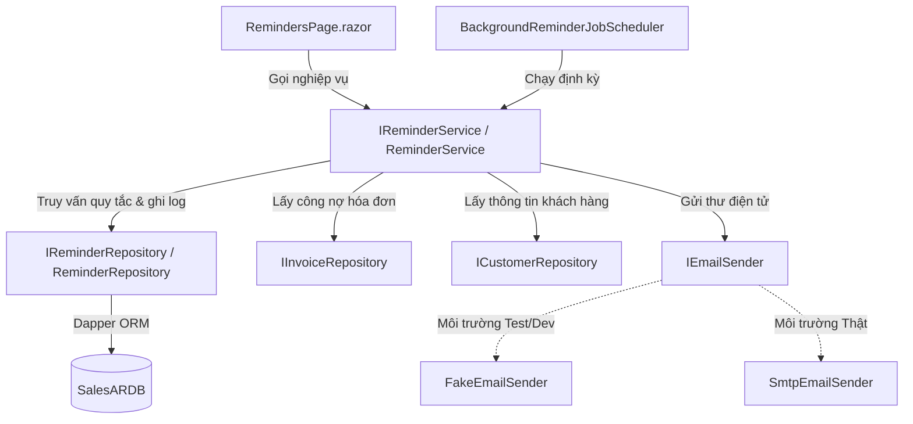
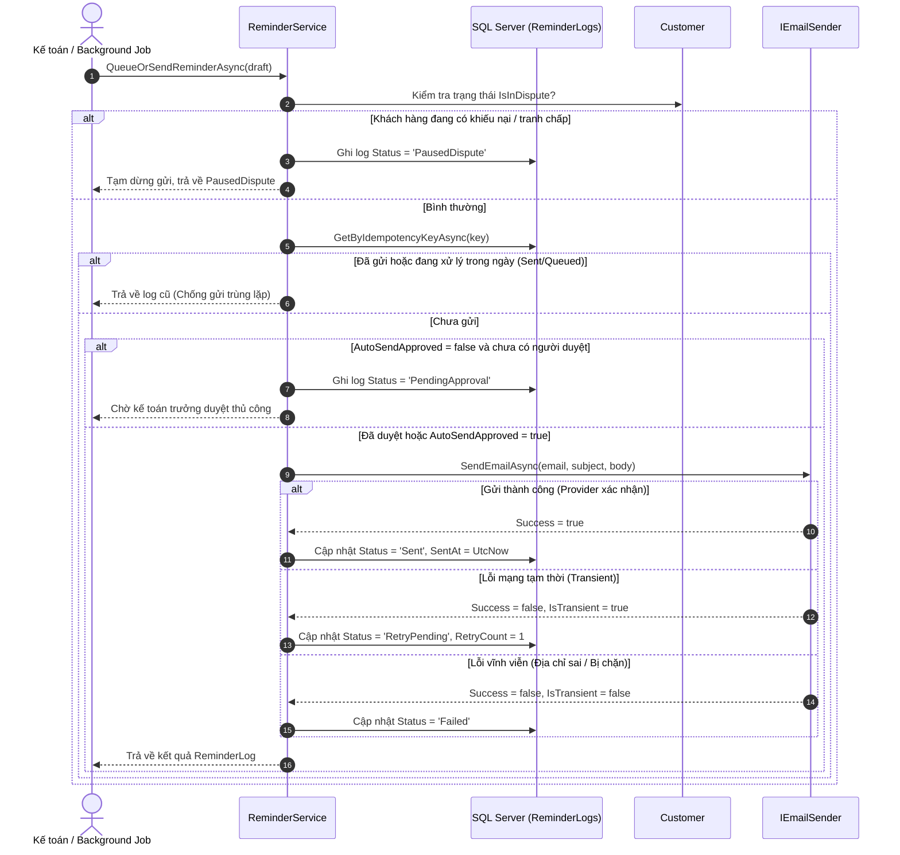

# TÀI LIỆU VẬN HÀNH & KIẾN TRÚC: NHẮC NỢ CÔNG NỢ TỰ ĐỘNG (PART 6/10)
## Đề tài 18: Bán hàng & Quản lý Công nợ Phải thu Khách hàng (Sales & AR)

---

## 1. Tổng Quan & Mục Tiêu

Hệ thống **Nhắc nợ công nợ tự động (Automated Debt Reminders)** được thiết kế nhằm giúp doanh nghiệp:
1. **Kiểm soát chặt chẽ kỳ hạn nợ**: Tự động phát hiện hóa đơn sắp đến hạn (ví dụ: trước 3 ngày) và các hóa đơn quá hạn (1-7 ngày, 8-30 ngày, >30 ngày).
2. **Chống gửi trùng lặp tuyệt đối**: Ứng dụng cơ chế **Idempotency Key** kết hợp ràng buộc `UNIQUE` ở tầng cơ sở dữ liệu (`ReminderLogs.IdempotencyKey`), ngăn chặn việc gửi thư nhiều lần trong ngày khi job chạy lại hoặc người dùng click thao tác đúp.
3. **Phân cấp giọng điệu (Tone of Voice)**: Lựa chọn mẫu thư phù hợp theo mức độ nghiêm trọng: Nhắc nhở hòa nhã (*Polite*), Kiên quyết (*Firm*), Khẩn cấp (*Urgent*), hoặc Thủ tục pháp lý (*Legal*).
4. **Bảo vệ quyền lợi khách hàng trong tranh chấp**: Cơ chế **Tạm dừng tự động** khi khách hàng hoặc hóa đơn đang có khiếu nại/tranh chấp chưa xử lý (`IsInDispute = true` -> trạng thái `PausedDispute`).
5. **Kiểm soát phê duyệt theo chính sách**: Quy tắc có cờ `AutoSendApproved = false` bắt buộc phải có kế toán trưởng/quản trị viên phê duyệt xác nhận trước khi thư được gửi đi (`PendingApproval`).
6. **Xử lý lỗi tạm thời & Hàng đợi Retry**: Khi nhà cung cấp email gặp sự cố tạm thời (mạng, timeout), hệ thống đưa vào hàng đợi `RetryPending` và tự động retry tối đa 3 lần. Chỉ đánh dấu `Sent` khi email provider xác nhận thành công.

---

## 2. Kiến Trúc Hệ Thống (Clean Architecture)

Tuân thủ nguyên tắc Clean Architecture, tầng giao diện Blazor UI (`.razor`) tuyệt đối không gửi email trực tiếp, không phụ thuộc vào hạ tầng SMTP/Network, mà thông qua các Port/Interface nghiệp vụ:



### Các Interface & Lớp thành phần:
- **`IReminderService`** (`SalesAR.UseCases.Reminders`):
  - `IdentifyReminderCandidatesAsync(asOfDate)`: Xác định ứng viên nợ, phân loại theo số ngày quá hạn và quy tắc áp dụng.
  - `GenerateReminderDraftAsync(customerId, invoiceIds, ruleId, asOfDate)`: Sinh bản nháp thư nhắc nợ cá nhân hóa (thay thế token `{CustomerName}`, `{TotalAmount}`, `{DueDate}`,...).
  - `QueueOrSendReminderAsync(draft, confirmedBy, forceSend)`: Kiểm tra tranh chấp, kiểm tra idempotency key, kiểm tra quyền phê duyệt và thực hiện gửi qua `IEmailSender`.
  - `ProcessPendingQueueAsync()`: Quét và retry các bản ghi `RetryPending`.
  - `PauseReminderForDisputeAsync` & `ResumeReminderFromDisputeAsync`: Quản lý luồng tạm dừng khi có khiếu nại.
- **`IEmailSender`** (`SalesAR.UseCases.Reminders`):
  - Interface trừu tượng độc lập với hạ tầng, trả về `EmailSendResult` (`Success`, `MessageId`, `ErrorMessage`, `IsTransientError`).
- **`IBackgroundJobScheduler`** (`SalesAR.UseCases.Reminders`):
  - Kích hoạt và theo dõi job chạy nền định kỳ.
- **`FakeEmailSender`** (`SalesAR.Plugins.Reminders`):
  - Cung cấp môi trường giả lập thử nghiệm ngay cả khi chưa có tài khoản SMTP, lưu vết lịch sử gửi trong bộ nhớ để kiểm thử unit test.
- **`SmtpEmailSender`** (`SalesAR.Plugins.Reminders`):
  - Thực thi gửi email qua giao thức SMTP chuẩn (`System.Net.Mail.SmtpClient`), tự động fallback sang `FakeEmailSender` an toàn nếu chưa cấu hình.

---

## 3. Quy Trình Nghiệp Vụ (Business Workflows)

### 3.1. Sơ đồ xử lý gửi nhắc nợ & Kiểm soát Idempotency



### 3.2. Cấu trúc Idempotency Key
Mỗi lần chuẩn bị gửi nhắc nợ, hệ thống sinh một khóa duy nhất theo định dạng:
$$\text{IdempotencyKey} = \text{REM-CUST-}\{\text{CustomerId}\}\text{-RULE-}\{\text{RuleId}\}\text{-}\{\text{yyyyMMdd}\}$$
- Bảng `ReminderLogs` có ràng buộc duy nhất:
  ```sql
  CONSTRAINT UQ_ReminderLogs_Idempotency UNIQUE (IdempotencyKey)
  ```
- Nhờ vậy, ngay cả khi 2 nhân viên cùng nhấn nút "Gửi" tại cùng một giây hoặc background job chạy 2 lần trong ngày, chỉ có 1 yêu cầu duy nhất được thực hiện, loại bỏ hoàn toàn rủi ro spam khách hàng.

---

## 4. Hướng Dẫn Cấu Hình Email Provider

Cấu hình email được đặt trong file [appsettings.json](file:///d:/L%E1%BA%ADp%20tr%C3%ACnh%20web/B%C3%80I%20THI/SalesAR.Web/appsettings.json):

```json
"EmailSettings": {
  "UseFakeSender": true,
  "SmtpHost": "smtp.gmail.com",
  "SmtpPort": 587,
  "EnableSsl": true,
  "SenderEmail": "no-reply@doanhnghiep.vn",
  "SenderName": "Phòng Kế Toán AR - Doanh Nghiệp ABC",
  "Username": "your-email@gmail.com",
  "Password": "your-app-password",
  "MaxRetryAttempts": 3,
  "RetryIntervalMinutes": 15
}
```

### 4.1. Chế độ Thử Nghiệm / Đồ Án (`UseFakeSender = true`)
- **Mục đích**: Chạy demo, chấm bài thi, kiểm thử không cần kết nối internet hay tài khoản email thật.
- **Hoạt động**: Email được in chi tiết ra Console (`[FAKE EMAIL SENDER]`) và lưu vết lịch sử trong bộ nhớ `FakeEmailSender.SentHistory`.

### 4.2. Chế độ Triển Khai Thực Tế (`UseFakeSender = false`)
Khi cấu hình gửi qua Gmail thật:
1. Đăng nhập tài khoản Google của công ty.
2. Bật xác thực 2 bước (2-Factor Authentication).
3. Tạo **Mật khẩu ứng dụng (App Password)** cho mục *Mail*.
4. Cập nhật `Username` và `Password` vào `appsettings.json`.
5. Đổi `"UseFakeSender": false`.

---

## 5. Bảng Dữ Liệu SQL Bổ Sung

Migration script nằm tại: [Database/08_AutomatedDebtReminders.sql](file:///d:/L%E1%BA%ADp%20tr%C3%ACnh%20web/B%C3%80I%20THI/Database/08_AutomatedDebtReminders.sql).

### 5.1. Bảng `ReminderRules` (Quy tắc nhắc nợ)
| Cột | Kiểu | Diễn giải |
|---|---|---|
| `Id` | `INT IDENTITY` | Khóa chính |
| `Name` | `NVARCHAR(100)` | Tên quy tắc (ví dụ: *Sắp đến hạn 3 ngày*) |
| `DaysOffset` | `INT` | Số ngày mốc: âm = trước hạn, dương = quá hạn |
| `TriggerType` | `NVARCHAR(50)` | `UpcomingDue` hoặc `Overdue` |
| `Tone` | `NVARCHAR(50)` | `Polite`, `Firm`, `Urgent`, `Legal` |
| `TemplateSubject` | `NVARCHAR(250)` | Mẫu tiêu đề thư với token thay thế |
| `TemplateBody` | `NVARCHAR(MAX)` | Mẫu nội dung thư HTML |
| `AutoSendApproved`| `BIT` | Cho phép tự động gửi mà không cần duyệt tay |
| `IsActive` | `BIT` | Trạng thái hiệu lực của quy tắc |

### 5.2. Bảng `ReminderLogs` (Nhật ký gửi & Hàng đợi Retry)
| Cột | Kiểu | Diễn giải |
|---|---|---|
| `Id` | `INT IDENTITY` | Khóa chính |
| `IdempotencyKey` | `VARCHAR(100)` | Khóa chống gửi trùng (`UNIQUE`) |
| `CustomerId` | `INT` | Khách hàng nhận thư |
| `RecipientEmail` | `NVARCHAR(150)` | Email người nhận |
| `Status` | `NVARCHAR(50)` | `Queued`, `PendingApproval`, `Sent`, `RetryPending`, `Failed`, `PausedDispute` |
| `RetryCount` | `INT` | Số lần đã thử gửi lại |
| `MaxRetries` | `INT` | Giới hạn số lần thử (mặc định 3) |
| `LastError` | `NVARCHAR(MAX)` | Thông điệp lỗi chi tiết từ provider |
| `SentAt` | `DATETIME2` | Thời điểm provider xác nhận gửi thành công |
| `ConfirmedBy` | `NVARCHAR(100)` | Người phê duyệt thư |

---

## 6. Giao Diện Người Dùng (`/reminders`)

Màn hình Quản lý Nhắc nợ công nợ tự động được tích hợp trực tiếp trên Blazor Web tại đường dẫn `/reminders` với các chức năng chính:
1. **Thống kê nhanh (KPI Cards)**: Số lượng nợ sắp đến hạn, nợ quá hạn, các hồ sơ đang tranh chấp cần xử lý, và các thư đang trong hàng đợi retry.
2. **Tab 1: Danh sách ứng viên cần nhắc nợ**: Phân nhóm khách hàng, hiển thị số ngày quá hạn cao nhất, tổng nợ, trạng thái tranh chấp.
   - Nút **Soạn/Xem bản nháp**: Mở modal biên tập nội dung, chọn mẫu câu theo quy tắc, xem trước nội dung sẽ gửi.
   - Nút **Đánh dấu Tranh chấp**: Tạm dừng nhắc nợ ngay tức khắc nếu khách hàng đang có khiếu nại chưa xử lý.
   - Nút **Gửi ngay**: Gửi email qua provider đã cấu hình, áp dụng kiểm tra Idempotency Key.
3. **Tab 2: Nhật ký gửi & Hàng đợi Retry**:
   - Theo dõi toàn bộ lịch sử gửi thư, chi tiết lỗi provider (nếu có), số lần retry.
   - Nút **Thử lại ngay**: Kích hoạt gửi lại ngay cho các bản ghi `RetryPending`.
   - Nút **Duyệt & Gửi**: Phê duyệt các bức thư đang ở trạng thái `PendingApproval`.
   - Nút **Khôi phục**: Tiếp tục gửi sau khi đã giải quyết xong khiếu nại tranh chấp.
4. **Nút "Kích hoạt Job Chạy Tự Động"**: Cho phép kích hoạt thủ công tác vụ định kỳ của `IBackgroundJobScheduler` bất cứ lúc nào.

---

## 7. Kết Quả Kiểm Thử (Unit Tests)

Bộ kiểm thử tự động trong [AutomatedDebtReminderTests.cs](file:///d:/L%E1%BA%ADp%20tr%C3%ACnh%20web/B%C3%80I%20THI/SalesAR.UnitTests/AutomatedDebtReminderTests.cs) bao gồm 8 kịch bản bao phủ toàn diện:

1. `IdentifyReminderCandidates_DetectsUpcomingDueAndOverdueInvoices`: Nhận diện chính xác hóa đơn sắp đến hạn (trước 2 ngày) và quá hạn (10 ngày), gán đúng Rule và Tone.
2. `IdentifyReminderCandidates_FlagsDisputedCustomers`: Khách hàng có tranh chấp được gắn cờ rõ ràng để cảnh báo.
3. `QueueOrSendReminder_PausesSending_WhenCustomerInDispute`: Tuyệt đối không gửi email khi khách hàng đang có tranh chấp; chuyển trạng thái `PausedDispute`.
4. `QueueOrSendReminder_PreventsDuplicateSending_UsingIdempotencyKey`: Chống gửi trùng lặp; khi gửi lại cùng Idempotency Key thì trả về kết quả cũ, số lượng email gửi thực tế không tăng.
5. `QueueOrSendReminder_RequiresApproval_WhenPolicyAutoSendIsFalse`: Đúng chính sách phê duyệt; khi `AutoSendApproved = false` và chưa có người duyệt, thư chuyển sang `PendingApproval` và không gửi email.
6. `ProcessReminder_RetriesTransientFailure_UpToMaxRetries`: Khi lỗi mạng tạm thời, tự động chuyển `RetryPending`, tăng `RetryCount`, và khi mạng phục hồi sẽ gửi thành công và chuyển `Sent`.
7. `ProcessReminder_MarksFailed_WhenMaxRetriesExceeded`: Khi vượt quá số lần thử tối đa (3 lần), chuyển sang `Failed` an toàn.
8. `PauseAndResume_HandlesDisputeWorkflowCorrectly`: Kiểm thử hoàn chỉnh chu trình Tạm dừng do tranh chấp $\rightarrow$ Khôi phục gửi sau giải quyết.

**Kết quả chạy thực tế:**
```text
Passed! - Failed: 0, Passed: 48, Skipped: 0, Total: 48, Duration: 400 ms - SalesAR.UnitTests.dll (net8.0)
```
100% test cases đạt tiêu chuẩn nghiệm thu của Part 6.
