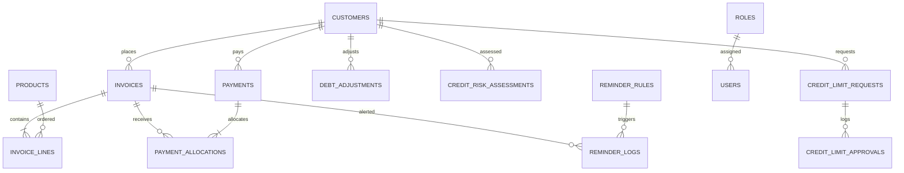

# 🗄 BÁO CÁO TOÀN VẸN CƠ SỞ DỮ LIỆU & QUẢN TRỊ THAY ĐỔI (DATABASE CHANGES & MIGRATIONS)
## ĐỒ ÁN MÔN HỌC: LẬP TRÌNH WEB
### Đề tài 18: Bán hàng & Quản lý Công nợ Phải thu Khách hàng (Sales & Accounts Receivable)

> **Giai đoạn**: `PART 10/10 — FINAL ACCEPTANCE & DATABASE CONSOLIDATION`  
> **Hệ quản trị CSDL**: Microsoft SQL Server 2022 / Express  
> **Tên cơ sở dữ liệu**: `SalesARDB`  
> **Tổng số bảng chuẩn hóa 3NF**: **15 bảng**  
> **Tổng số Migration Scripts**: **8 scripts SQL lũy kế** (`Database/01_...` đến `Database/08_...`)

---

## 1. TỔNG QUAN TIẾN TRÌNH MIGRATION CƠ SỞ DỮ LIỆU

Toàn bộ CSDL được quản lý thông qua 8 file migration tuần tự trong thư mục `Database/`:

| STT | File Script Migration | Nội dung & Bảng tạo mới / sửa đổi | Mục tiêu nghiệp vụ |
|:---:|:---|:---|:---|
| 1 | `01_CreateDatabase.sql` | `CREATE DATABASE SalesARDB` | Khởi tạo CSDL với bảng mã Unicode UTF-8 |
| 2 | `02_CreateTables.sql` | `Customers`, `Products`, `Invoices`, `InvoiceLines`, `Payments`, `PaymentAllocations` | Các bảng bán hàng và công nợ nền tảng |
| 3 | `03_CreateRelationships.sql` | Khóa ngoại PK-FK, Unique (`Code`, `InvoiceNumber`, `PaymentNumber`), Check (`Amount > 0`) | Ràng buộc toàn vẹn dữ liệu và tính toán tài chính |
| 4 | `04_InsertSampleData.sql` | Dữ liệu mẫu đối tác khách hàng, sản phẩm, hóa đơn bán | Dữ liệu kiểm thử ban đầu |
| 5 | `05_CreateAuthTables.sql` | `Roles`, `Users`, hạt giống tài khoản mẫu (`admin`, `sales`, `accountant`) | Xác thực và phân quyền RBAC |
| 6 | `06_AuditAndIntegrityEnhancement.sql` | `DebtAdjustments`, `AuditLogs`, Composite Indexes | Nhật ký kiểm toán, cấn trừ nợ và tối ưu truy vấn |
| 7 | `07_CreditLimitApprovalWorkflow.sql` | `CreditLimitRequests`, `CreditLimitApprovals`, bổ sung vai trò `CREDIT_MANAGER` | Quy trình duyệt vượt hạn mức & SoD |
| 8 | `08_AutomatedDebtReminders.sql` | `ReminderRules`, `ReminderLogs`, `CreditRiskAssessments`, cờ `IsInDispute` | Tự động nhắc nợ, đánh giá rủi ro AI & tranh chấp |

---

## 2. TỪ ĐIỂN DỮ LIỆU 15 BẢNG CHUẨN HÓA 3NF (DATA DICTIONARY)

Hệ thống quản lý **15 bảng chuẩn hóa 3NF** không dư thừa dữ liệu:



### Danh mục chi tiết 15 bảng:

1. **`dbo.Customers`** (Hồ sơ khách hàng & hạn mức tín dụng):
   - `Id` (INT, PK, Identity), `Code` (NVARCHAR(50), UQ), `Name` (NVARCHAR(200)), `Phone` (NVARCHAR(20)), `Email` (NVARCHAR(150)), `Address` (NVARCHAR(500)), `CreditLimit` (DECIMAL(18,2), CHECK >= 0), `PaymentTermDays` (INT, CHECK >= 0), `IsInDispute` (BIT, Default 0), `DisputeReason` (NVARCHAR(500)), `IsActive` (BIT, Default 1).
2. **`dbo.Products`** (Danh mục hàng hóa & tồn kho):
   - `Id` (INT, PK, Identity), `Code` (NVARCHAR(50), UQ), `Name` (NVARCHAR(200)), `Unit` (NVARCHAR(50)), `Price` (DECIMAL(18,2), CHECK >= 0), `StockQuantity` (INT, CHECK >= 0), `IsActive` (BIT, Default 1).
3. **`dbo.Invoices`** (Hóa đơn bán hàng):
   - `Id` (INT, PK, Identity), `InvoiceNumber` (NVARCHAR(50), UQ), `CustomerId` (INT, FK -> Customers), `InvoiceDate` (DATETIME2), `DueDate` (DATETIME2), `TotalAmount` (DECIMAL(18,2), CHECK >= 0), `Status` (NVARCHAR(50), CHECK IN ('Unpaid', 'PartiallyPaid', 'Paid', 'Cancelled')), `IsInDispute` (BIT, Default 0), `DisputeReason` (NVARCHAR(500)).
4. **`dbo.InvoiceLines`** (Chi tiết từng dòng mặt hàng trong hóa đơn):
   - `Id` (INT, PK, Identity), `InvoiceId` (INT, FK -> Invoices CASCADE), `ProductId` (INT, FK -> Products), `Quantity` (INT, CHECK > 0), `UnitPrice` (DECIMAL(18,2), CHECK >= 0), `Amount` (DECIMAL(18,2), CHECK >= 0).
5. **`dbo.Payments`** (Phiếu thu tiền khách hàng):
   - `Id` (INT, PK, Identity), `PaymentNumber` (NVARCHAR(50), UQ), `CustomerId` (INT, FK -> Customers), `Amount` (DECIMAL(18,2), CHECK > 0), `PaymentDate` (DATETIME2), `Note` (NVARCHAR(500)).
6. **`dbo.PaymentAllocations`** (Phân bổ số tiền thu cho hóa đơn theo FIFO):
   - `Id` (INT, PK, Identity), `PaymentId` (INT, FK -> Payments CASCADE), `InvoiceId` (INT, FK -> Invoices), `AllocatedAmount` (DECIMAL(18,2), CHECK > 0).
7. **`dbo.Roles`** (Danh mục vai trò bảo mật):
   - `Id` (INT, PK, Identity), `Name` (NVARCHAR(50), UQ - `ADMIN`, `SALES`, `ACCOUNTANT`, `CREDIT_MANAGER`), `Description` (NVARCHAR(250)).
8. **`dbo.Users`** (Tài khoản người dùng):
   - `Id` (INT, PK, Identity), `Username` (NVARCHAR(50), UQ), `PasswordHash` (NVARCHAR(255) - PBKDF2/SHA-256 salted hash), `FullName` (NVARCHAR(150)), `Email` (NVARCHAR(150)), `RoleId` (INT, FK -> Roles), `IsActive` (BIT, Default 1), `CreatedAt` (DATETIME2).
9. **`dbo.DebtAdjustments`** (Lịch sử điều chỉnh công nợ, chiết khấu, xóa nợ):
   - `Id` (INT, PK, Identity), `AdjustmentNumber` (NVARCHAR(50), UQ), `CustomerId` (INT, FK -> Customers), `InvoiceId` (INT, Nullable, FK -> Invoices), `AdjustmentType` (NVARCHAR(50)), `Amount` (DECIMAL(18,2), CHECK > 0), `Reason` (NVARCHAR(500)), `AdjustedBy` (NVARCHAR(50)), `AdjustedAt` (DATETIME2).
10. **`dbo.AuditLogs`** (Nhật ký kiểm toán hệ thống):
    - `Id` (INT, PK, Identity), `TableName` (NVARCHAR(100)), `RecordId` (INT), `Action` (NVARCHAR(50)), `OldValues` (NVARCHAR(MAX)), `NewValues` (NVARCHAR(MAX)), `ChangedBy` (NVARCHAR(50)), `ChangedAt` (DATETIME2), `Reason` (NVARCHAR(500)).
11. **`dbo.CreditLimitRequests`** (Đơn yêu cầu duyệt vượt hạn mức tín dụng):
    - `Id` (INT, PK, Identity), `RequestNumber` (NVARCHAR(50), UQ), `CustomerId` (INT, FK -> Customers), `TransactionAmount` (DECIMAL(18,2), CHECK > 0), `CurrentDebtSnapshot` (DECIMAL(18,2)), `CreditLimitSnapshot` (DECIMAL(18,2)), `Reason` (NVARCHAR(500)), `Status` (NVARCHAR(50), CHECK IN ('Pending', 'Approved', 'Rejected', 'Cancelled')), `RequestedBy` (NVARCHAR(50)), `RequestedAt` (DATETIME2), `ApprovedBy` (NVARCHAR(50)), `ApprovedAt` (DATETIME2), `DecisionReason` (NVARCHAR(500)), `ExpiresAt` (DATETIME2), `IsUsed` (BIT, Default 0), `UsedAt` (DATETIME2), `UsedInvoiceId` (INT, Nullable, FK -> Invoices).
12. **`dbo.CreditLimitApprovals`** (Lịch sử phê duyệt hạn mức):
    - `Id` (INT, PK, Identity), `RequestId` (INT, FK -> CreditLimitRequests), `Action` (NVARCHAR(50) - `SUBMIT`, `APPROVE`, `REJECT`, `CANCEL`), `Actor` (NVARCHAR(50)), `ActionAt` (DATETIME2), `Comment` (NVARCHAR(500)), `CurrentDebtAtDecision` (DECIMAL(18,2)), `CreditLimitAtDecision` (DECIMAL(18,2)).
13. **`dbo.ReminderRules`** (Quy tắc cấu hình nhắc nợ tự động):
    - `Id` (INT, PK, Identity), `Name` (NVARCHAR(150)), `DaysOffset` (INT), `TriggerType` (NVARCHAR(50) - `UpcomingDue`, `Overdue`), `Tone` (NVARCHAR(50) - `Polite`, `Neutral`, `Firm`, `Urgent`), `TemplateSubject` (NVARCHAR(250)), `TemplateBody` (NVARCHAR(MAX)), `AutoSendApproved` (BIT, Default 0), `IsActive` (BIT, Default 1).
14. **`dbo.ReminderLogs`** (Nhật ký gửi nhắc nợ):
    - `Id` (INT, PK, Identity), `InvoiceId` (INT, Nullable, FK -> Invoices), `CustomerId` (INT, FK -> Customers), `ReminderRuleId` (INT, FK -> ReminderRules), `Tone` (NVARCHAR(50)), `RecipientEmail` (NVARCHAR(150)), `Subject` (NVARCHAR(250)), `Body` (NVARCHAR(MAX)), `SentAt` (DATETIME2), `Status` (NVARCHAR(50) - `Sent`, `RetryPending`, `Failed`, `PausedDispute`), `RetryCount` (INT, Default 0), `LastError` (NVARCHAR(MAX)), `IdempotencyKey` (NVARCHAR(100), UQ), `ConfirmedBy` (NVARCHAR(50)).
15. **`dbo.CreditRiskAssessments`** (Lịch sử chấm điểm rủi ro tín dụng do AI / Rule-based):
    - `Id` (INT, PK, Identity), `CustomerId` (INT, FK -> Customers), `RiskScore` (DECIMAL(5,2)), `RiskLevel` (NVARCHAR(50)), `ModelVersion` (NVARCHAR(50)), `EvaluationSummary` (NVARCHAR(MAX)), `RequiresHumanReview` (BIT), `AssessedAt` (DATETIME2), `AssessedBy` (NVARCHAR(50)).

---

## 3. CÁC NGUYÊN TẮC TOÀN VẸN & BẢO TOÀN DỮ LIỆU ĐÃ KIỂM CHỨNG

1. **Bảo toàn số học tiền tệ (Decimal Precision)**:
   - 100% cột giá trị tài chính sử dụng `DECIMAL(18,2)`. Tuyệt đối không dùng `FLOAT` hay `REAL` để loại trừ hiện tượng trôi dấu phẩy động.
2. **Khóa bi quan chống Race Condition**:
   - Truy vấn phê duyệt sử dụng hint `WITH (UPDLOCK, HOLDLOCK)`:
     ```sql
     SELECT * FROM dbo.CreditLimitRequests WITH (UPDLOCK, HOLDLOCK) WHERE Id = @Id;
     ```
3. **Khóa lạc quan nguyên tử chống dùng lại Approval (Anti-Replay)**:
   - Cập nhật tiêu thụ phiếu duyệt với điều kiện `IsUsed = 0`:
     ```sql
     UPDATE dbo.CreditLimitRequests SET IsUsed = 1, UsedAt = SYSDATETIME(), UsedInvoiceId = @InvoiceId WHERE Id = @Id AND IsUsed = 0;
     ```
4. **Ràng buộc Chống trùng thanh toán**:
   - Khóa duy nhất `UQ_Payments_PaymentNumber` bắt buộc mọi mã phiếu thu là duy nhất trong toàn hệ thống.

---

## 4. QUY TRÌNH SAO LƯU & PHỤC HỒI (BACKUP & RESTORE PROCEDURES)

### 4.1. Lệnh Sao Lưu Toàn Diện (Full Backup)
```sql
BACKUP DATABASE SalesARDB
TO DISK = N'C:\Backups\SalesARDB_Full_Backup.bak'
WITH FORMAT, INIT, NAME = N'SalesARDB Full Database Backup', STATS = 10;
GO
```

### 4.2. Lệnh Phục Hồi Database (Restore)
```sql
USE master;
GO
ALTER DATABASE SalesARDB SET SINGLE_USER WITH ROLLBACK IMMEDIATE;
GO
RESTORE DATABASE SalesARDB
FROM DISK = N'C:\Backups\SalesARDB_Full_Backup.bak'
WITH REPLACE, STATS = 10;
GO
ALTER DATABASE SalesARDB SET MULTI_USER;
GO
```
