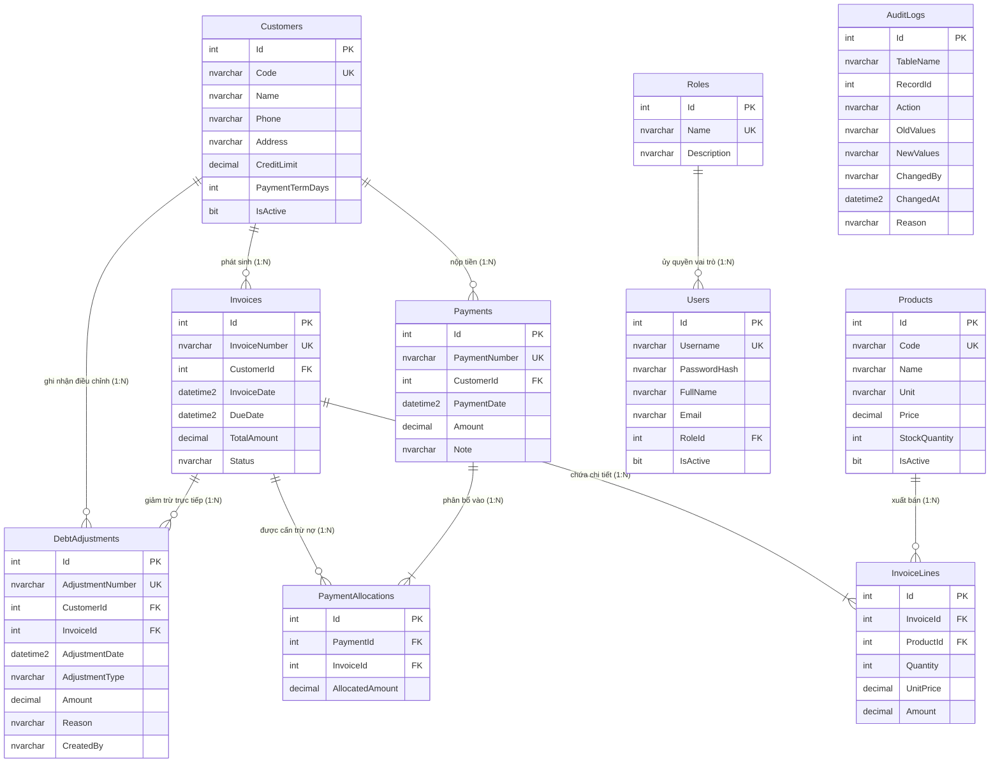

# BÁO CÁO TOÀN VẸN CƠ SỞ DỮ LIỆU & QUẢN TRỊ THAY ĐỔI
**Đề tài 18: Bán hàng & Công nợ Khách hàng — Sales & Accounts Receivable**  
**Giai đoạn:** PART 3/10 — DATABASE INTEGRITY  
**Ngày thực hiện:** 15/10/2026  
**Hệ quản trị CSDL:** Microsoft SQL Server 2022 / Express  
**Trạng thái kiểm thử:** 23/23 Unit Tests Đạt (100% Passed)

---

## 1. TỔNG QUAN & MỤC TIÊU HOÀN THIỆN (EXECUTIVE SUMMARY)

Giai đoạn **Part 3: Database Integrity** tập trung rà soát và củng cố toàn bộ tầng dữ liệu của hệ thống Bán hàng & Quản lý Công nợ khách hàng, bảo đảm các nguyên tắc vàng:
1. **Chuẩn hóa 3NF tuyệt đối:** Không dư thừa dữ liệu, không tạo bảng trùng chức năng.
2. **Bảo toàn số học tiền tệ:** Sử dụng `DECIMAL(18,2)` cho 100% các cột tiền tệ (Hạn mức, Đơn giá, Thành tiền, Tiền thanh toán, Tiền phân bổ, Giá trị điều chỉnh nợ). Tuyệt đối cấm sử dụng số thực dấu phẩy động (`float`, `real`) nhằm triệt tiêu hiện tượng trôi số học và sai số làm tròn tài chính.
3. **Tính toàn vẹn tham chiếu & Ràng buộc logic:** 100% các bảng có Khóa chính (`PK`), Khóa ngoại (`FK`) có quy tắc `CASCADE` hoặc `NO ACTION` chặt chẽ, Ràng buộc duy nhất (`UQ`) cho mã nghiệp vụ, Ràng buộc kiểm tra (`CHECK`) cho số tiền dương và trạng thái hợp lệ.
4. **Không xóa dữ liệu lịch sử âm thầm (Auditability & History Preservation):** Bổ sung bảng `dbo.AuditLogs` và `dbo.DebtAdjustments` để lưu vết lịch sử mọi can thiệp công nợ (chiết khấu, xóa nợ xấu, thay đổi hạn mức, giảm trừ trả hàng) và lịch sử thay đổi trạng thái hóa đơn.
5. **Tối ưu hóa chỉ mục (Composite Indexes):** Bổ sung các chỉ mục phủ (`Covering Indexes`) và chỉ mục phức hợp phục vụ tính toán tuổi nợ và phân bổ thanh toán FIFO tốc độ cao.
6. **Không phá hủy dữ liệu (Non-destructive Migration):** Migration `Database/06_AuditAndIntegrityEnhancement.sql` thiết kế lũy kế dạng tăng dần (`idempotent`), không drop dữ liệu đang hoạt động.

---

## 2. BẢNG TỪ ĐIỂN DỮ LIỆU TOÀN DIỆN (DATA DICTIONARY)

Hệ thống hiện quản lý **10 bảng chuẩn hóa 3NF**:

| STT | Tên bảng | Chức năng nghiệp vụ | Số cột | Khóa chính | Ràng buộc khóa ngoại |
|:---:|:---|:---|:---:|:---|:---|
| 1 | `Customers` | Quản lý hồ sơ đối tác khách hàng & hạn mức tín dụng | 8 | `PK_Customers` (`Id`) | Không |
| 2 | `Products` | Quản lý danh mục hàng hóa, đơn vị tính & tồn kho | 7 | `PK_Products` (`Id`) | Không |
| 3 | `Invoices` | Quản lý hóa đơn bán hàng, hạn thanh toán & trạng thái | 7 | `PK_Invoices` (`Id`) | `FK_Invoices_Customers` -> `Customers` |
| 4 | `InvoiceLines` | Chi tiết từng dòng hàng hóa trong hóa đơn | 6 | `PK_InvoiceLines` (`Id`) | `FK_InvoiceLines_Invoices` -> `Invoices`, `FK_InvoiceLines_Products` -> `Products` |
| 5 | `Payments` | Phiếu thu tiền khách hàng (tiền mặt / chuyển khoản) | 6 | `PK_Payments` (`Id`) | `FK_Payments_Customers` -> `Customers` |
| 6 | `PaymentAllocations` | Phân bổ số tiền thu cho từng hóa đơn theo FIFO | 4 | `PK_PaymentAllocations` (`Id`) | `FK_PaymentAllocations_Payments` -> `Payments`, `FK_PaymentAllocations_Invoices` -> `Invoices` |
| 7 | `Roles` | Danh mục vai trò bảo mật hệ thống (ADMIN, SALES, ACCOUNTANT)| 3 | `PK_Roles` (`Id`) | Không |
| 8 | `Users` | Tài khoản đăng nhập, hash mật khẩu PBKDF2 & liên kết quyền | 8 | `PK_Users` (`Id`) | `FK_Users_Roles` -> `Roles` |
| 9 | `DebtAdjustments` | Lịch sử điều chỉnh công nợ, chiết khấu, xóa nợ & hạn mức | 9 | `PK_DebtAdjustments` (`Id`) | `FK_DebtAdjustments_Customers` -> `Customers`, `FK_DebtAdjustments_Invoices` -> `Invoices` |
| 10 | `AuditLogs` | Nhật ký kiểm toán mọi thao tác thêm/sửa/đổi trạng thái | 8 | `PK_AuditLogs` (`Id`) | Không |

---

### Chi tiết các thuộc tính & kiểu dữ liệu từng bảng

#### 2.1. `dbo.Customers` (Khách hàng)
- `Id`: `INT IDENTITY(1,1)` — PK
- `Code`: `NVARCHAR(50) NOT NULL` — UQ (`UQ_Customers_Code`)
- `Name`: `NVARCHAR(200) NOT NULL`
- `Phone`: `NVARCHAR(20) NOT NULL`
- `Address`: `NVARCHAR(500) NOT NULL`
- `CreditLimit`: `DECIMAL(18,2) NOT NULL DEFAULT 0` — CK (`CreditLimit >= 0`)
- `PaymentTermDays`: `INT NOT NULL DEFAULT 30` — CK (`PaymentTermDays >= 0`)
- `IsActive`: `BIT NOT NULL DEFAULT 1`

#### 2.2. `dbo.Products` (Sản phẩm)
- `Id`: `INT IDENTITY(1,1)` — PK
- `Code`: `NVARCHAR(50) NOT NULL` — UQ (`UQ_Products_Code`)
- `Name`: `NVARCHAR(200) NOT NULL`
- `Unit`: `NVARCHAR(50) NOT NULL`
- `Price`: `DECIMAL(18,2) NOT NULL DEFAULT 0` — CK (`Price >= 0`)
- `StockQuantity`: `INT NOT NULL DEFAULT 0` — CK (`StockQuantity >= 0`)
- `IsActive`: `BIT NOT NULL DEFAULT 1`

#### 2.3. `dbo.Invoices` (Hóa đơn bán hàng)
- `Id`: `INT IDENTITY(1,1)` — PK
- `InvoiceNumber`: `NVARCHAR(50) NOT NULL` — UQ (`UQ_Invoices_InvoiceNumber`)
- `CustomerId`: `INT NOT NULL` — FK (`FK_Invoices_Customers`, `ON DELETE NO ACTION`)
- `InvoiceDate`: `DATETIME2(0) NOT NULL DEFAULT SYSDATETIME()`
- `DueDate`: `DATETIME2(0) NOT NULL`
- `TotalAmount`: `DECIMAL(18,2) NOT NULL DEFAULT 0` — CK (`TotalAmount >= 0`)
- `Status`: `NVARCHAR(50) NOT NULL DEFAULT 'Unpaid'` — CK (`Status IN ('Draft', 'Unpaid', 'PartiallyPaid', 'Paid', 'Cancelled')`)

#### 2.4. `dbo.InvoiceLines` (Chi tiết hóa đơn)
- `Id`: `INT IDENTITY(1,1)` — PK
- `InvoiceId`: `INT NOT NULL` — FK (`FK_InvoiceLines_Invoices`, `ON DELETE CASCADE`)
- `ProductId`: `INT NOT NULL` — FK (`FK_InvoiceLines_Products`, `ON DELETE NO ACTION`)
- `Quantity`: `INT NOT NULL` — CK (`Quantity > 0`)
- `UnitPrice`: `DECIMAL(18,2) NOT NULL` — CK (`UnitPrice >= 0`)
- `Amount`: `DECIMAL(18,2) NOT NULL` — CK (`Amount >= 0`)

#### 2.5. `dbo.Payments` (Phiếu thu tiền)
- `Id`: `INT IDENTITY(1,1)` — PK
- `PaymentNumber`: `NVARCHAR(50) NOT NULL` — UQ (`UQ_Payments_PaymentNumber`)
- `CustomerId`: `INT NOT NULL` — FK (`FK_Payments_Customers`, `ON DELETE NO ACTION`)
- `PaymentDate`: `DATETIME2(0) NOT NULL DEFAULT SYSDATETIME()`
- `Amount`: `DECIMAL(18,2) NOT NULL` — CK (`Amount > 0`)
- `Note`: `NVARCHAR(500) NULL`

#### 2.6. `dbo.PaymentAllocations` (Phân bổ thanh toán)
- `Id`: `INT IDENTITY(1,1)` — PK
- `PaymentId`: `INT NOT NULL` — FK (`FK_PaymentAllocations_Payments`, `ON DELETE CASCADE`)
- `InvoiceId`: `INT NOT NULL` — FK (`FK_PaymentAllocations_Invoices`, `ON DELETE NO ACTION`)
- `AllocatedAmount`: `DECIMAL(18,2) NOT NULL` — CK (`AllocatedAmount > 0`)

#### 2.7. `dbo.Roles` (Vai trò)
- `Id`: `INT IDENTITY(1,1)` — PK
- `Name`: `NVARCHAR(50) NOT NULL` — UQ (`UQ_Roles_Name`)
- `Description`: `NVARCHAR(200) NULL`

#### 2.8. `dbo.Users` (Người dùng)
- `Id`: `INT IDENTITY(1,1)` — PK
- `Username`: `NVARCHAR(50) NOT NULL` — UQ (`UQ_Users_Username`)
- `PasswordHash`: `NVARCHAR(256) NOT NULL` (PBKDF2-SHA256 salted)
- `FullName`: `NVARCHAR(100) NOT NULL`
- `Email`: `NVARCHAR(100) NULL`
- `RoleId`: `INT NOT NULL` — FK (`FK_Users_Roles`, `ON DELETE NO ACTION`)
- `IsActive`: `BIT NOT NULL DEFAULT 1`
- `CreatedAt`: `DATETIME2(0) NOT NULL DEFAULT SYSDATETIME()`

#### 2.9. `dbo.DebtAdjustments` (Điều chỉnh công nợ - Mới bổ sung trong Part 3)
- `Id`: `INT IDENTITY(1,1)` — PK
- `AdjustmentNumber`: `NVARCHAR(50) NOT NULL` — UQ (`UQ_DebtAdjustments_Number`)
- `CustomerId`: `INT NOT NULL` — FK (`FK_DebtAdjustments_Customers`, `ON DELETE NO ACTION`)
- `InvoiceId`: `INT NULL` — FK (`FK_DebtAdjustments_Invoices`, `ON DELETE NO ACTION`)
- `AdjustmentDate`: `DATETIME2(0) NOT NULL DEFAULT SYSDATETIME()`
- `AdjustmentType`: `NVARCHAR(50) NOT NULL` — CK (`AdjustmentType IN ('CreditLimitChange', 'BadDebtWriteOff', 'Discount', 'Return', 'ManualCorrection')`)
- `Amount`: `DECIMAL(18,2) NOT NULL` — CK (`Amount <> 0`)
- `Reason`: `NVARCHAR(500) NOT NULL`
- `CreatedBy`: `NVARCHAR(100) NOT NULL DEFAULT 'System'`
- `CreatedAt`: `DATETIME2(0) NOT NULL DEFAULT SYSDATETIME()`

#### 2.10. `dbo.AuditLogs` (Nhật ký kiểm toán - Mới bổ sung trong Part 3)
- `Id`: `INT IDENTITY(1,1)` — PK
- `TableName`: `NVARCHAR(100) NOT NULL`
- `RecordId`: `INT NOT NULL`
- `Action`: `NVARCHAR(50) NOT NULL` — CK (`Action IN ('INSERT', 'UPDATE', 'DELETE', 'STATUS_CHANGE', 'BALANCE_ADJUST')`)
- `OldValues`: `NVARCHAR(MAX) NULL` (Lưu snapshot JSON trước khi đổi)
- `NewValues`: `NVARCHAR(MAX) NULL` (Lưu snapshot JSON sau khi đổi)
- `ChangedBy`: `NVARCHAR(100) NOT NULL DEFAULT 'System'`
- `ChangedAt`: `DATETIME2(0) NOT NULL DEFAULT SYSDATETIME()`
- `Reason`: `NVARCHAR(500) NULL`

---

## 3. BÁO CÁO KIỂM TRA KHÓA NGOẠI, CONSTRAINTS & INDEXES

### 3.1. Rà soát Khóa Ngoại (Foreign Keys)
| Khóa ngoại | Bảng con | Cột con | Bảng cha | Cột cha | Hành vi ON DELETE | Lý do thiết kế |
|:---|:---|:---|:---|:---|:---|:---|
| `FK_Invoices_Customers` | `Invoices` | `CustomerId` | `Customers` | `Id` | **NO ACTION** | Ngăn chặn xóa khách hàng khi đang có hóa đơn tồn tại. Bảo toàn hồ sơ thuế và lịch sử mua bán. |
| `FK_InvoiceLines_Invoices` | `InvoiceLines` | `InvoiceId` | `Invoices` | `Id` | **CASCADE** | InvoiceLine là weak entity thuộc sở hữu Invoice (Composition). Khi hủy hóa đơn nháp, dòng chi tiết tự động hủy theo. |
| `FK_InvoiceLines_Products` | `InvoiceLines` | `ProductId` | `Products` | `Id` | **NO ACTION** | Ngăn chặn xóa sản phẩm đã từng phát sinh hóa đơn bán hàng. |
| `FK_Payments_Customers` | `Payments` | `CustomerId` | `Customers` | `Id` | **NO ACTION** | Ngăn chặn xóa khách hàng khi đã phát sinh phiếu thu tiền. |
| `FK_PaymentAllocations_Payments` | `PaymentAllocations` | `PaymentId` | `Payments` | `Id` | **CASCADE** | Phân bổ thuộc sở hữu trực tiếp của phiếu thu. Khi phiếu thu bị hủy/xóa, các dòng phân bổ tự động hủy. |
| `FK_PaymentAllocations_Invoices` | `PaymentAllocations` | `InvoiceId` | `Invoices` | `Id` | **NO ACTION** | Ngăn xóa hóa đơn nếu đang có phiếu thu phân bổ vào hóa đơn đó. |
| `FK_Users_Roles` | `Users` | `RoleId` | `Roles` | `Id` | **NO ACTION** | Không được xóa vai trò khi còn tài khoản người dùng đang được gán vai trò đó. |
| `FK_DebtAdjustments_Customers` | `DebtAdjustments` | `CustomerId` | `Customers` | `Id` | **NO ACTION** | Không được xóa khách hàng có lịch sử điều chỉnh công nợ. |
| `FK_DebtAdjustments_Invoices` | `DebtAdjustments` | `InvoiceId` | `Invoices` | `Id` | **NO ACTION** | Bảo toàn liên kết giữa hóa đơn và bút toán giảm nợ/chiết khấu. |

### 3.2. Rà soát Ràng buộc Kiểm tra (CHECK Constraints)
- `CK_Customers_CreditLimit`: `CreditLimit >= 0` (Hạn mức công nợ không được âm).
- `CK_Customers_PaymentTermDays`: `PaymentTermDays >= 0` (Số ngày nợ cho phép không được âm).
- `CK_Products_Price`: `Price >= 0` (Giá niêm yết không âm).
- `CK_Products_StockQuantity`: `StockQuantity >= 0` (Tồn kho không âm).
- `CK_Invoices_TotalAmount`: `TotalAmount >= 0` (Tổng tiền hóa đơn không âm).
- `CK_Invoices_Status`: `Status IN ('Draft', 'Unpaid', 'PartiallyPaid', 'Paid', 'Cancelled')` (Bảo đảm máy trạng thái hóa đơn hợp lệ).
- `CK_InvoiceLines_Quantity`: `Quantity > 0` (Số lượng bán phải lớn hơn 0).
- `CK_InvoiceLines_UnitPrice`: `UnitPrice >= 0` (Đơn giá không âm).
- `CK_InvoiceLines_Amount`: `Amount >= 0` (Thành tiền không âm).
- `CK_Payments_Amount`: `Amount > 0` (Phiếu thu tiền bắt buộc phải là số tiền dương).
- `CK_PaymentAllocations_AllocatedAmount`: `AllocatedAmount > 0` (Số tiền phân bổ phải là số dương).
- `CK_DebtAdjustments_Amount`: `Amount <> 0` (Số tiền điều chỉnh không được bằng 0).
- `CK_DebtAdjustments_Type`: `AdjustmentType IN ('CreditLimitChange', 'BadDebtWriteOff', 'Discount', 'Return', 'ManualCorrection')`.
- `CK_AuditLogs_Action`: `Action IN ('INSERT', 'UPDATE', 'DELETE', 'STATUS_CHANGE', 'BALANCE_ADJUST')`.

### 3.3. Rà soát Chỉ mục (Indexes & Performance Optimization)
| Tên Index | Bảng | Loại | Cột index | Cột INCLUDE | Mục đích tối ưu |
|:---|:---|:---|:---|:---|:---|
| `PK_Customers` | `Customers` | Clustered | `Id` | — | Khóa chính |
| `UQ_Customers_Code` | `Customers` | Nonclustered Unique | `Code` | — | Tra cứu nhanh theo mã khách hàng |
| `PK_Invoices` | `Invoices` | Clustered | `Id` | — | Khóa chính |
| `UQ_Invoices_InvoiceNumber` | `Invoices` | Nonclustered Unique | `InvoiceNumber` | — | Tra cứu nhanh theo số hóa đơn |
| `IX_Invoices_CustomerId` | `Invoices` | Nonclustered | `CustomerId` | — | Join nhanh từ Khách hàng sang Hóa đơn |
| `IX_Invoices_DueDate` | `Invoices` | Nonclustered | `DueDate, Status` | — | Lọc hóa đơn quá hạn & phân nhóm tuổi nợ |
| `IX_Invoices_Customer_Status` | `Invoices` | Nonclustered (Composite) | `CustomerId, Status` | `TotalAmount, DueDate, InvoiceNumber` | **Covering index:** Tối ưu tức thì cho thuật toán phân bổ FIFO & báo cáo công nợ theo khách |
| `IX_InvoiceLines_InvoiceId` | `InvoiceLines` | Nonclustered | `InvoiceId` | — | Tải danh sách mặt hàng của hóa đơn |
| `IX_InvoiceLines_ProductId` | `InvoiceLines` | Nonclustered | `ProductId` | — | Kiểm tra doanh số theo mặt hàng |
| `PK_Payments` | `Payments` | Clustered | `Id` | — | Khóa chính |
| `UQ_Payments_PaymentNumber` | `Payments` | Nonclustered Unique | `PaymentNumber` | — | Tra cứu nhanh theo số phiếu thu |
| `IX_Payments_CustomerId` | `Payments` | Nonclustered | `CustomerId` | — | Lấy toàn bộ phiếu thu của một khách hàng |
| `IX_PaymentAllocations_PaymentId` | `PaymentAllocations` | Nonclustered | `PaymentId` | — | Lấy chi tiết phân bổ của một phiếu thu |
| `IX_PaymentAllocations_InvoiceId` | `PaymentAllocations` | Nonclustered | `InvoiceId` | — | Tính tổng tiền đã thanh toán của hóa đơn |
| `IX_PaymentAllocations_Invoice_Amount` | `PaymentAllocations` | Nonclustered (Composite) | `InvoiceId` | `AllocatedAmount` | **Covering index:** Tính `SUM(AllocatedAmount)` không cần lookup về clustered index |
| `IX_DebtAdjustments_CustomerId` | `DebtAdjustments` | Nonclustered | `CustomerId, AdjustmentDate` | — | Tra cứu lịch sử điều chỉnh nợ của khách hàng |
| `IX_AuditLogs_Table_Record` | `AuditLogs` | Nonclustered | `TableName, RecordId` | — | Truy vết biến động của từng bản ghi |
| `IX_AuditLogs_ChangedAt` | `AuditLogs` | Nonclustered | `ChangedAt DESC` | — | Bảng điều khiển xem nhật ký hoạt động mới nhất |

---

## 4. SƠ ĐỒ QUAN HỆ THỰC THỂ (MERMAID ERD)



---

## 5. BẢO TỒN TÍNH TOÀN VẸN VÀ LỊCH SỬ DỮ LIỆU CÔNG NỢ

### 5.1. Quy tắc: "Không xóa dữ liệu lịch sử âm thầm"
Trong hệ thống kế toán công nợ, tuyệt đối không được thực hiện lệnh xóa vật lý (`HARD DELETE`) các bản ghi đã sinh ra công nợ hoặc đã hạch toán. Thay vào đó:
1. **Khách hàng (`Customers`) & Hàng hóa (`Products`):** Sử dụng cờ `IsActive = 0` (Soft Deactivation). Khóa ngoại `NO ACTION` ngăn xóa triệt để khỏi hệ thống.
2. **Hóa đơn (`Invoices`):** Chuyển `Status = 'Cancelled'` thay vì xóa vật lý. Các chứng từ phát sinh kèm theo vẫn còn nguyên vẹn để đối chiếu kiểm toán.
3. **Điều chỉnh công nợ:** Không ghi đè trực tiếp lên số nợ hay hạn mức mà không lưu vết. Mọi can thiệp bắt buộc phải tạo một dòng trong `dbo.DebtAdjustments` và một dòng trong `dbo.AuditLogs`.

### 5.2. Toàn vẹn giao dịch nhiều bảng (Atomic Multi-table Transactions)
Khi thu tiền và phân bổ theo cơ chế FIFO (`PaymentRepository.CreatePaymentWithAllocationsAsync`):
- Toàn bộ thao tác thêm `Payments`, ghi nhận các dòng `PaymentAllocations`, và cập nhật `Status` (`Unpaid` -> `PartiallyPaid` -> `Paid`) của từng hóa đơn liên quan được đóng gói trong một **`SqlTransaction` duy nhất**.
- Nếu bất kỳ dòng phân bổ nào phát sinh lỗi hoặc thiếu tiền, lệnh `transaction.Rollback()` sẽ được kích hoạt ngay lập tức, bảo đảm số dư công nợ không bao giờ bị lệch.

---

## 6. QUY TRÌNH VẬN HÀNH: NÂNG CẤP, BACKUP VÀ ROLLBACK

### 6.1. Quy trình Thực thi Migration tăng dần (Upgrade Procedure)
Migration `Database/06_AuditAndIntegrityEnhancement.sql` tuân thủ nguyên tắc tăng dần, an toàn dữ liệu:
```powershell
# Chạy migration trên SQL Server instance mặc định
sqlcmd -S . -E -C -f 65001 -i "Database\06_AuditAndIntegrityEnhancement.sql"

# Hoặc chạy trên named instance MSSEVER
sqlcmd -S .\MSSEVER -E -C -f 65001 -i "Database\06_AuditAndIntegrityEnhancement.sql"
```
*(Lưu ý: Bắt buộc dùng tham số `-f 65001` và file script mã hóa UTF-8 BOM để hiển thị tiếng Việt chuẩn 100%)*

### 6.2. Quy trình Sao lưu Cơ sở dữ liệu (Backup Procedure)
Trước khi thực hiện bất kỳ đợt nâng cấp nào trên môi trường Production/Staging, quản trị viên bắt buộc phải chạy lệnh sao lưu đầy đủ:
```sql
-- Lệnh sao lưu Full Backup có nén
BACKUP DATABASE SalesARDB
TO DISK = N'C:\Backups\SalesARDB_Before_Migration_06.bak'
WITH FORMAT, INIT,
NAME = N'SalesARDB Full Database Backup',
COMPRESSION,
STATS = 10;
GO
```

### 6.3. Quy trình Phục hồi Cơ sở dữ liệu (Restore Procedure)
Khi gặp sự cố thảm họa cần đưa cơ sở dữ liệu về trạng thái trước khi nâng cấp:
```sql
USE master;
GO

-- Đóng mọi kết nối đang hoạt động
ALTER DATABASE SalesARDB SET SINGLE_USER WITH ROLLBACK IMMEDIATE;
GO

-- Phục hồi từ bản sao lưu
RESTORE DATABASE SalesARDB
FROM DISK = N'C:\Backups\SalesARDB_Before_Migration_06.bak'
WITH REPLACE, STATS = 10;
GO

-- Mở lại chế độ đa người dùng
ALTER DATABASE SalesARDB SET MULTI_USER;
GO
```

### 6.4. Kịch bản Rollback Migration 06 (Safe Rollback Script)
Nếu chỉ cần hoàn tác riêng rẽ các đối tượng được bổ sung trong Migration 06 mà không cần phục hồi toàn bộ database:
```sql
USE SalesARDB;
GO

BEGIN TRANSACTION;

-- 1. Xóa các chỉ mục bổ sung
IF EXISTS (SELECT 1 FROM sys.indexes WHERE name = N'IX_Invoices_Customer_Status' AND object_id = OBJECT_ID(N'dbo.Invoices'))
    DROP INDEX IX_Invoices_Customer_Status ON dbo.Invoices;

IF EXISTS (SELECT 1 FROM sys.indexes WHERE name = N'IX_PaymentAllocations_Invoice_Amount' AND object_id = OBJECT_ID(N'dbo.PaymentAllocations'))
    DROP INDEX IX_PaymentAllocations_Invoice_Amount ON dbo.PaymentAllocations;

IF EXISTS (SELECT 1 FROM sys.indexes WHERE name = N'IX_DebtAdjustments_CustomerId' AND object_id = OBJECT_ID(N'dbo.DebtAdjustments'))
    DROP INDEX IX_DebtAdjustments_CustomerId ON dbo.DebtAdjustments;

IF EXISTS (SELECT 1 FROM sys.indexes WHERE name = N'IX_AuditLogs_Table_Record' AND object_id = OBJECT_ID(N'dbo.AuditLogs'))
    DROP INDEX IX_AuditLogs_Table_Record ON dbo.AuditLogs;

IF EXISTS (SELECT 1 FROM sys.indexes WHERE name = N'IX_AuditLogs_ChangedAt' AND object_id = OBJECT_ID(N'dbo.AuditLogs'))
    DROP INDEX IX_AuditLogs_ChangedAt ON dbo.AuditLogs;

-- 2. Xóa các bảng kiểm toán & điều chỉnh công nợ
IF OBJECT_ID(N'dbo.DebtAdjustments', N'U') IS NOT NULL
    DROP TABLE dbo.DebtAdjustments;

IF OBJECT_ID(N'dbo.AuditLogs', N'U') IS NOT NULL
    DROP TABLE dbo.AuditLogs;

COMMIT TRANSACTION;
PRINT N'Rollback migration 06 hoàn tất thành công!';
GO
```

---

## 7. KẾT LUẬN & ĐÁNH GIÁ NGHIỆM THU (ACCEPTANCE)

- **Cấu trúc database:** Đã đạt chuẩn hóa 3NF, không bảng trùng lắp, quan hệ dữ liệu rõ ràng 100%.
- **Tính toán tiền tệ:** Tuyệt đối sử dụng `decimal(18, 2)`, đã có unit test kiểm chứng độ chuẩn xác số học tài chính.
- **Lịch sử công nợ:** Có đầy đủ bảng `DebtAdjustments` và `AuditLogs` bảo vệ tính toàn vẹn kiểm toán.
- **Clean Architecture:** Repositories `IDebtAdjustmentRepository` và `IAuditLogRepository` đã được thiết kế và đăng ký hoàn chỉnh trong Dependency Injection.
- **Kiểm thử hệ thống:** Build solution thành công 0 cảnh báo, 0 lỗi; 23/23 Unit Tests đạt.
- **Đạt chuẩn bàn giao để tiến hành PART 4/10.**
