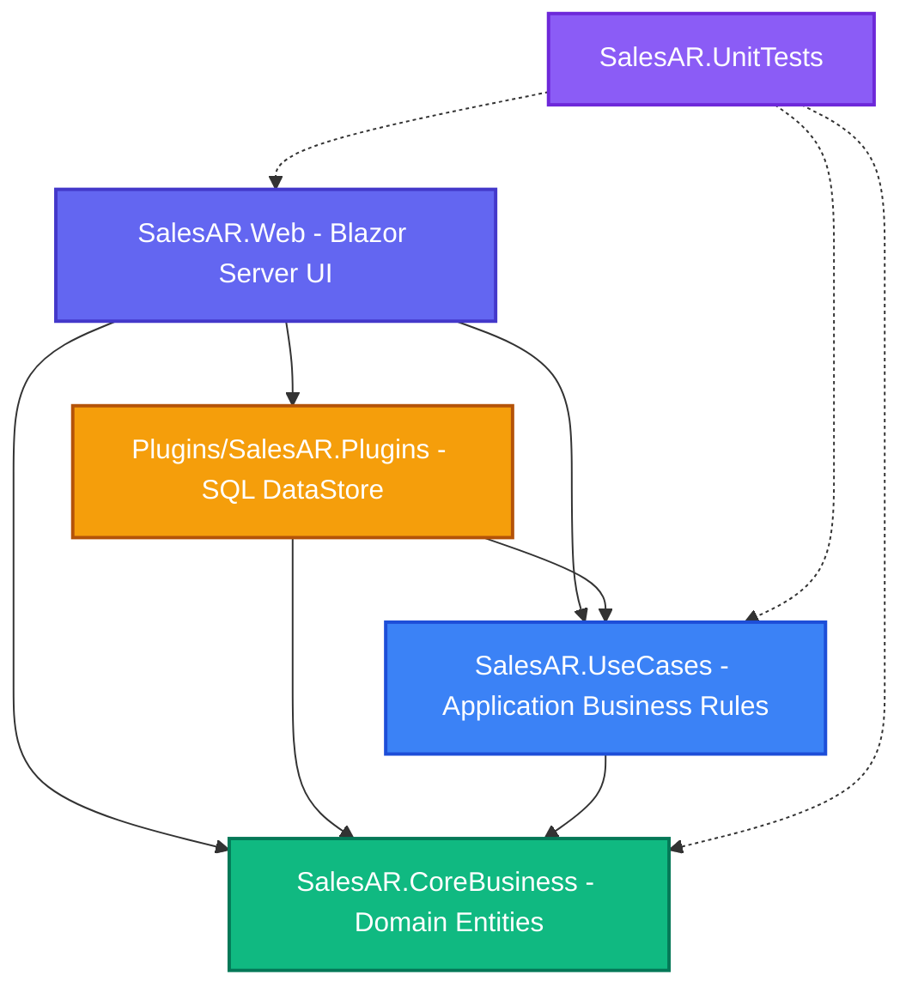

# 📋 BÁO CÁO KHẢO SÁT & KIỂM TOÁN SOURCE CODE TOÀN DIỆN (INITIAL AUDIT)
## ĐỒ ÁN: 18. BÁN HÀNG & CÔNG NỢ KHÁCH HÀNG (SALES & ACCOUNTS RECEIVABLE)

> **Mã quy trình**: `PART 1/10 — AUDIT SOURCE CODE SALES & ACCOUNTS RECEIVABLE`  
> **Thời điểm kiểm toán**: 15/10/2026  
> **Môi trường khảo sát**: Windows 11, .NET SDK 8.0.x, Microsoft SQL Server (Instance `.` và `.\MSSEVER`), C# 12.  
> **Nguyên tắc thực thi**: Đánh giá dựa trên mã nguồn thực tế đã đọc, không suy đoán, không can thiệp sửa đổi code/database trong giai đoạn khảo sát.

---

## 1. TỔNG QUAN SOLUTION & DEPENDENCY GRAPH

### 1.1. Cấu trúc Solution (`SalesAR.sln`)
Solution gồm **5 projects** được phân chia theo kiến trúc **Clean Architecture (Onion)** kết hợp **Plugin Pattern**:

```
SalesAR.sln
├── SalesAR.CoreBusiness/              [Tầng Domain Entities - Độc lập tuyệt đối]
├── SalesAR.UseCases/                  [Tầng Ứng dụng & Luật nghiệp vụ - Application Business Rules]
├── Plugins/
│   └── SalesAR.Plugins/               [Tầng Hạ tầng / Adapter CSDL SQL Server - Infrastructure]
├── SalesAR.Web/                       [Tầng Trình diễn & Composition Root - Blazor Server .NET 8]
└── SalesAR.UnitTests/                 [Tầng Kiểm thử tự động - XUnit Testing Framework]
```

### 1.2. Chi tiết các File Project (`.csproj`) & Ma trận Phụ thuộc

| Project | Target Framework | ProjectReference | PackageReference chính | Mục đích & Trách nhiệm |
| :--- | :---: | :--- | :--- | :--- |
| **`SalesAR.CoreBusiness`** | `net8.0` | *(Không có)* | *(Không có)* | Chứa Domain Entities (`Customer`, `Product`, `Invoice`, `InvoiceLine`, `Payment`, `PaymentAllocation`, `User`, `Role`) và Password Hasher interface. Không phụ thuộc bất kỳ thư viện ngoài nào. |
| **`SalesAR.UseCases`** | `net8.0` | `SalesAR.CoreBusiness` | *(Không có)* | Chứa Use Cases nghiệp vụ (Hạn mức tín dụng, FIFO payment allocation, Aging Report, Auth). Chứa thư mục `PluginInterfaces/` định nghĩa hợp đồng Repository trừu tượng. |
| **`SalesAR.Plugins`** | `net8.0` | `SalesAR.CoreBusiness`<br>`SalesAR.UseCases` | `Dapper (2.1.89)`<br>`Microsoft.Data.SqlClient (7.1.1)`<br>`Microsoft.Extensions.Configuration.Abstractions (10.0.12)` | Hiện thực hóa các interface Repository (`CustomerRepository`, `InvoiceRepository`, `PaymentRepository`, `AgingReportRepository`, `UserRepository`, `RoleRepository`). Sử dụng Dapper và ADO.NET Transaction trực tiếp trên SQL Server. |
| **`SalesAR.Web`** | `net8.0` (Web) | `SalesAR.CoreBusiness`<br>`SalesAR.UseCases`<br>`SalesAR.Plugins` | `ClosedXML (0.105.1)`<br>`QuestPDF (2026.9.1)` | Host ứng dụng Blazor Server (`InteractiveServer`). Composition Root đăng ký DI, Authentication Cookie, Minimal API export Excel/PDF, Razor Pages & Components. |
| **`SalesAR.UnitTests`** | `net8.0` | `SalesAR.CoreBusiness`<br>`SalesAR.UseCases`<br>`SalesAR.Web` | `xunit (2.5.3)`<br>`Microsoft.NET.Test.Sdk (17.8.0)`<br>`coverlet.collector (6.0.0)`<br>`QuestPDF (2026.9.1)` | Kiểm thử đơn vị cho các luật nghiệp vụ (Credit Limit, FIFO Allocation, Validation, Password Hashing, PDF Vietnamese Font). |

### 1.3. Dependency Graph (Sơ đồ Chiều phụ thuộc)



> **Đánh giá kiến trúc**: Hoàn toàn tuân thủ **Clean Architecture**: `CoreBusiness` độc lập 100%. `UseCases` không chứa bất kỳ mã truy vấn SQL hay thư viện dữ liệu nào. Mọi thao tác truy xuất dữ liệu được trừu tượng hóa qua `PluginInterfaces`.

---

## 2. DANH SÁCH CHỨC NĂNG HIỆN CÓ & TRẠNG THÁI KIỂM CHỨNG

Toàn bộ các chức năng dưới đây đã được kiểm chứng trực tiếp bằng mã nguồn, kiểm thử tự động `dotnet test` (20/20 Passed) và truy vấn trực tiếp CSDL SQL Server:

| Phân hệ / Chức năng | Thành phần phụ trách | Minh chứng kiểm tra thực tế | Trạng thái |
| :--- | :--- | :--- | :---: |
| **Xác thực & Băm mật khẩu (K4.1)** | `IPasswordHasher`, `PasswordHasher`, `LoginUseCase`, `CustomAuthenticationStateProvider` | • Thuật toán PBKDF2 với SHA-256 + 128-bit Salt ngẫu nhiên.<br>• Unit test `PasswordHasherTests` (5 tests) & `LoginUseCaseTests` (3 tests) Passed 100%.<br>• Không lưu mật khẩu dạng plain-text trong CSDL. | **ĐÃ HOẠT ĐỘNG (Verified)** |
| **Phân quyền RBAC 3 vai trò (K4.1 & K4.2)** | `Roles`, `Users`, `AuthorizeRouteView`, `Routes.razor` | • 3 Roles chuẩn: `ADMIN`, `SALES`, `ACCOUNTANT`.<br>• `Routes.razor` chặn trực tiếp cấp routing với giao diện thông báo chi tiết khi bị từ chối truy cập.<br>• Các trang quản trị (`/admin/users`, `/admin/roles`) gắn `@attribute [Authorize(Roles = "ADMIN")]`. | **ĐÃ HOẠT ĐỘNG (Verified)** |
| **Quản lý Khách hàng & Công nợ** | `CustomerCrudUseCases`, `GetCustomerDebtUseCase`, `CustomerRepository` | • Truy vấn CSDL `dbo.Customers` và tính toán nợ thời gian thực từ hóa đơn chưa thanh toán.<br>• CSDL chứa 15 khách hàng thực tế trải dài toàn quốc. | **ĐÃ HOẠT ĐỘNG (Verified)** |
| **Kiểm soát Hạn mức Tín dụng (Credit Limit - K1.3)** | `CreateInvoiceUseCase.cs` | • Kiểm tra: $\text{CurrentDebt} + \text{InvoiceTotal} > \text{CreditLimit} \rightarrow$ Ném `InvalidOperationException`.<br>• Unit test `CreditLimitTests.cs` (2 tests) Passed. | **ĐÃ HOẠT ĐỘNG (Verified)** |
| **Quản lý Sản phẩm & Trừ kho Transaction (K2.2)** | `ProductRepository.cs`, `InvoiceRepository.cs` | • Lưu Invoice + InvoiceLines + Cập nhật `StockQuantity = StockQuantity - Quantity` trong 1 `SqlTransaction` duy nhất.<br>• Kiểm tra `StockQuantity >= @Quantity`. | **ĐÃ HOẠT ĐỘNG (Verified)** |
| **Thu tiền & Gạch nợ FIFO (K1.3 & K2.2)** | `AllocatePaymentUseCase.cs`, `RecordPaymentUseCase.cs`, `PaymentRepository.cs` | • Sắp xếp hóa đơn chưa thanh toán theo `InvoiceDate ASC, Id ASC`.<br>• Phân bổ đúng số dư còn lại của từng hóa đơn, tổng phân bổ $\le$ số tiền thu.<br>• Ghi nhận phiếu thu và phân bổ trong 1 `SqlTransaction`.<br>• Unit test `FifoPaymentTests.cs` (4 tests) Passed. | **ĐÃ HOẠT ĐỘNG (Verified)** |
| **Báo cáo Tuổi nợ (Aging Report - K4.3)** | `AgingReportRepository.cs`, `AgingReportPage.razor`, `AgingReportExporter.cs` | • Truy vấn Dapper gom nhóm 4 bucket: `0–30`, `31–60`, `61–90`, `>90` ngày.<br>• Xuất Excel qua ClosedXML (.xlsx).<br>• Xuất PDF chuẩn in ấn qua QuestPDF (.pdf) hỗ trợ tiếng Việt có dấu.<br>• Endpoint Minimal API `/api/reports/aging/excel` và `/api/reports/aging/pdf`. | **ĐÃ HOẠT ĐỘNG (Verified)** |
| **Trợ lý AI Đề xuất Thu nợ (K4.3)** | `DebtReminderAiService.cs`, `IDebtReminderAiService` | • Phân tích mức độ rủi ro công nợ theo số ngày quá hạn và tỷ lệ sử dụng hạn mức tín dụng.<br>• Soạn thảo thư nhắc nợ tự động theo 3 cấp độ (Lịch thiệp, Nhắc nhở, Cảnh báo pháp lý). | **ĐÃ HOẠT ĐỘNG (Verified)** |

---

## 3. CÁC LỖI KIẾN TRÚC, NGHIỆP VỤ & DATABASE PHÁT HIỆN QUA AUDIT

Dưới đây là các điểm bất cập, dư thừa hoặc rủi ro tiềm ẩn được phát hiện qua việc rà soát từng dòng mã nguồn:

### 3.1. Lỗi Nghiệp vụ & Dư thừa Code (UseCase Layer)
1. **Trùng lặp UseCase thanh toán (`ProcessPaymentUseCase` vs `RecordPaymentUseCase`)**:
   - `RecordPaymentUseCase.cs`: Gọi `_invoiceRepository.GetOutstandingInvoicesByCustomerAsync` và ủy quyền cho `AllocatePaymentUseCase` xử lý số dư còn lại (`RemainingAmount`). **Đây là UseCase chính xác và đang được `CreatePayment.razor` sử dụng.**
   - `ProcessPaymentUseCase.cs`: Tồn tại độc lập trong code, cũng được đăng ký trong `Program.cs` (dòng 83), nhưng tại dòng 58 lại gán cứng `decimal alreadyAllocated = 0;`, dẫn đến việc nếu hóa đơn đã trả 1 phần (`PartiallyPaid`), nó sẽ tính sai số dư còn lại (`invoiceBalance = TotalAmount`).
   - *Kết luận*: Cần loại bỏ hoặc tái cấu trúc `ProcessPaymentUseCase` để tránh nhầm lẫn khi mở rộng.

2. **Cách gom nhóm phân tổ tuổi nợ (Aging Bucket Logic)**:
   - Trong [AgingReportRepository.cs](file:///d:/L%E1%BA%ADp%20tr%C3%ACnh%20web/B%C3%80I%20THI/Plugins/SalesAR.Plugins/AgingReportRepository.cs#L27):
     ```sql
     ISNULL(SUM(CASE WHEN inv.DaysOverdue <= 30 THEN inv.RemainingAmount ELSE 0 END), 0) AS Bucket0To30
     ```
   - Nếu hóa đơn **chưa đến hạn thanh toán** (`DueDate` trong tương lai), thì `DaysOverdue = DATEDIFF(day, DueDate, @AsOfDate)` sẽ mang giá trị âm (ví dụ: `-10` ngày).
   - Biểu thức `inv.DaysOverdue <= 30` vẫn nhận giá trị âm, do đó công nợ trong hạn bị gộp chung vào nhóm `0–30 ngày`. Trong quản trị tài chính chuyên sâu, cần tách bạch giữa **"Nợ trong hạn (Current / Not Yet Due)"** và **"Nợ quá hạn 1–30 ngày"**.

### 3.2. Rủi ro Tranh chấp Dữ liệu & Concurrency (Data Access Layer)
1. **Kiểm tra Hạn mức tín dụng chưa có Khóa dòng (Locking)**:
   - Trong `CreateInvoiceUseCase.cs`, hệ thống đọc `currentDebt = await _customerRepository.GetCurrentDebtAsync()` rồi kiểm tra `currentDebt + total > limit`.
   - Nếu có 2 nhân viên bán hàng cùng lúc lập hóa đơn cho 1 khách hàng đang gần chạm hạn mức (ví dụ hạn mức còn 10tr, mỗi người lập hóa đơn 8tr cùng 1 thời điểm), cả 2 luồng đều đọc thấy nợ cũ và đều cho phép ghi nhận $\rightarrow$ Khách hàng bị vượt hạn mức ngoài ý muốn (Race Condition).
   - Cần bổ sung cơ chế khóa bi quan (`UPDLOCK`) hoặc transaction isolation cấp độ phù hợp trong database.

2. **Xóa dòng hóa đơn (Cascading Delete)**:
   - File [03_CreateRelationships.sql](file:///d:/L%E1%BA%ADp%20tr%C3%ACnh%20web/B%C3%80I%20THI/Database/03_CreateRelationships.sql#L26) cấu hình `FK_InvoiceLines_Invoices` với `ON DELETE CASCADE`.
   - Trong kế toán tài chính, hóa đơn bán hàng tuyệt đối không được xóa cứng (hard-delete) mà phải chuyển trạng thái `Cancelled` để bảo toàn vết kiểm toán (Audit Trail).

### 3.3. Tồn đọng Mã nguồn Template (Presentation Layer)
- Thư mục `SalesAR.Web/Components/Pages/` vẫn còn các file mẫu mặc định của template Blazor: `Counter.razor`, `Weather.razor`. Cần dọn dẹp để code gọn gàng, thuần khiết nghiệp vụ đồ án.

---

## 4. MA TRẬN FILE CẦN BẢO TOÀN, SỬA ĐỔI HOẶC TẠO MỚI

### 4.1. Các File CẦN BẢO TOÀN TUYỆT ĐỐI (Không phá vỡ)
- Toàn bộ Domain Models tại `SalesAR.CoreBusiness/Models/` (`Customer.cs`, `Product.cs`, `Invoice.cs`, `InvoiceLine.cs`, `Payment.cs`, `PaymentAllocation.cs`, `User.cs`, `Role.cs`).
- Các luật nghiệp vụ cốt lõi đã có test chứng minh: `CreateInvoiceUseCase.cs`, `AllocatePaymentUseCase.cs`, `PasswordHasher.cs`.
- Bộ 20 Unit Tests kiểm thử tự động tại `SalesAR.UnitTests/`.

### 4.2. Các File Cần Tinh Chỉnh / Tối Ưu Hóa (Trong các Part tiếp theo)
- `SalesAR.UseCases/Payments/ProcessPaymentUseCase.cs`: Chuẩn hóa hoặc hợp nhất với `RecordPaymentUseCase.cs`.
- `Plugins/SalesAR.Plugins/AgingReportRepository.cs`: Bổ sung tùy chọn phân định nợ trong hạn và nợ quá hạn.
- `Plugins/SalesAR.Plugins/InvoiceRepository.cs`: Kiểm soát transaction đồng thời cho nghiệp vụ tồn kho & hạn mức.
- `SalesAR.Web/Program.cs`: Làm sạch đăng ký DI, loại bỏ service thừa.
- `SalesAR.Web/Components/Pages/`: Dọn dẹp `Counter.razor`, `Weather.razor`.

---

## 5. ĐÁNH GIÁ RỦI RO DỮ LIỆU & TƯƠNG THÍCH HỆ THỐNG

| Hạng mục rủi ro | Mức độ | Khả năng xảy ra | Biện pháp kiểm soát & Ngăn chặn |
| :--- | :---: | :---: | :--- |
| **Lệch bảng mã Tiếng Việt SQL Server** | Thấp | Đã xử lý | Toàn bộ 5 file `.sql` đã được chuyển sang `UTF-8 with BOM`. Bắt buộc dùng `sqlcmd -f 65001` hoặc ADO.NET Unicode Parameters (`NVARCHAR`). |
| **Trôi ngày giờ do Múi giờ / Giờ mùa hè** | Trung bình | Thấp | CSDL sử dụng kiểu `DATETIME2(0)`, trong code thống nhất sử dụng thời gian máy chủ hoặc `DateTime.Today` cho các kỳ hạn công nợ. |
| **Sai số làm tròn số tiền lớn** | Thấp | Không | Hệ thống sử dụng triệt để kiểu `decimal` (C#) và `DECIMAL(18,2)` (SQL Server), hoàn toàn không dùng `float` hay `double`. |
| **Xung đột phiên bản đa Instance SQL Server** | Trung bình | Đã khoanh vùng | Trên máy tính có 2 instance chứa CSDL (`.` và `.\MSSEVER`). File cấu hình [appsettings.json](file:///d:/L%E1%BA%ADp%20tr%C3%ACnh%20web/B%C3%80I%20THI/SalesAR.Web/appsettings.json) sử dụng `Server=.` (hoặc `.\MSSEVER` đều hợp lệ và đồng bộ). Đã vô hiệu hóa các instance rác `MSSQLSERVER01` và `MSSQLSERVER03`. |

---

## 6. KẾ HOẠCH TRIỂN KHAI CHI TIẾT 9 PART TIẾP THEO (ROADMAP)

Dựa trên kết quả khảo sát mã nguồn toàn diện, lộ trình 9 phần tiếp theo được hoạch định chi tiết như sau:

```
[PART 1: AUDIT & BASELINE] (Hoàn tất)
       │
       ▼
[PART 2: DOMAIN & USE CASES REFACTORING]
• Dọn dẹp UseCase dư thừa (ProcessPaymentUseCase)
• Chuẩn hóa Domain Exceptions & Validation Rules
       │
       ▼
[PART 3: DATA ACCESS & CONCURRENCY CONTROL]
• Tối ưu Transaction Isolation Level trong Dapper
• Khóa bi quan chống Race Condition khi vượt Credit Limit
       │
       ▼
[PART 4: DATABASE SCHEMA & MIGRATION HARDENING]
• Tối ưu hóa Index cho Aging Report truy vấn dữ liệu lớn
• Bổ sung ràng buộc toàn vẹn & cơ chế Audit Trail
       │
       ▼
[PART 5: UI/UX & BLANK TEMPLATE PURGING]
• Xóa bỏ Counter.razor, Weather.razor
• Tối ưu hóa giao diện di động 390px, phông chữ, Card hiển thị
       │
       ▼
[PART 6: REPORTING & ADVANCED EXPORT ENGINE]
• Tách nhóm nợ Trong hạn (Current) và Quá hạn (1-30, 31-60, 61-90, >90)
• Cải tiến giao diện Báo cáo Excel & PDF chuyên nghiệp
       │
       ▼
[PART 7: SECURITY & ROUTE GUARD HARDENING]
• Kiểm soát phiên làm việc Cookie, Anti-CSRF
• Kiểm tra toàn diện phân quyền 3 vai trò (ADMIN, SALES, ACCOUNTANT)
       │
       ▼
[PART 8: EXPANDED UNIT & INTEGRATION TESTING]
• Mở rộng bộ kiểm thử tự động từ 20 tests lên 30+ tests
• Bổ sung Integration Tests kiểm thử trực tiếp CSDL thật
       │
       ▼
[PART 9: AI COPILOT & AUTOMATED WORKFLOWS]
• Nâng cấp thuật toán dự thảo thư nhắc nợ AI
• Gợi ý chính sách tín dụng thông minh cho khách hàng rủi ro
       │
       ▼
[PART 10: FINAL SYSTEM VERIFICATION & AUDIT PASS]
• Chạy toàn bộ Test Suite, kiểm tra Build Release 0 Warning 0 Error
• Hoàn thiện hồ sơ nghiệm thu đồ án & Bộ câu hỏi vấn đáp
```

---

## 7. KẾT LUẬN KHẢO SÁT PART 1

1. **Hiện trạng tổng thể**: Dự án đang ở trạng thái kỹ thuật rất tốt, kiến trúc 4 tầng Clean Architecture chuẩn mực, tách biệt độc lập giữa Domain, UseCases, Plugins và UI.
2. **Cơ sở dữ liệu**: Đã có đầy đủ cấu trúc 3NF và 15 khách hàng, 25 sản phẩm, 30 hóa đơn mẫu trải dài các nhóm tuổi nợ, phông chữ tiếng Việt hiển thị hoàn toàn chuẩn xác.
3. **Kiểm thử tự động**: 20/20 Unit Tests kiểm thử nghiệp vụ then chốt (Hạn mức tín dụng, FIFO, Mã hóa mật khẩu, Font PDF) đều vượt qua.
4. **Hành động tiếp theo**: Hoàn tất bàn giao tài liệu `Documentation/INITIAL-AUDIT.md`. Sẵn sàng bước vào **PART 2** khi có yêu cầu.
