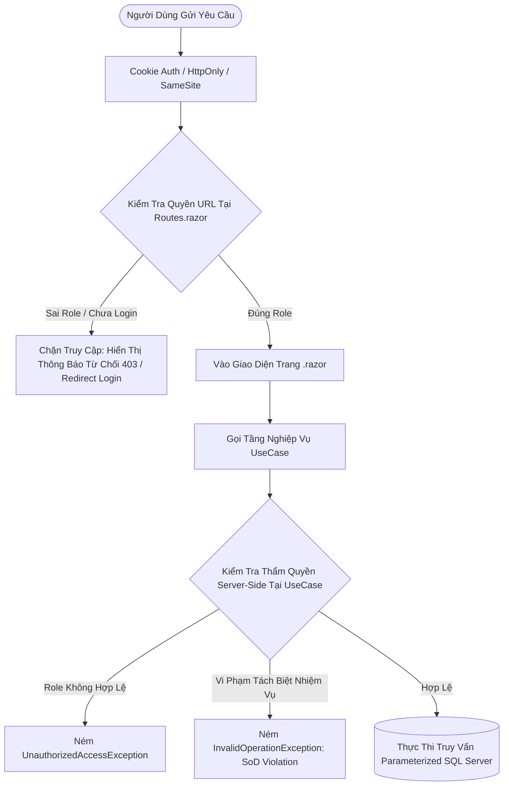

# BÁO CÁO BẢO MẬT, PHÂN QUYỀN & KIỂM TOÁN HỆ THỐNG (PART 9/10)
## Đề tài 18: Bán hàng & Quản lý Công nợ Phải thu Khách hàng (Sales & Accounts Receivable)
## Tiêu chuẩn: Enterprise Security, RBAC Matrix, Audit Trail & Mobile Responsiveness

---

## 1. Tổng Quan & Triết Lý Bảo Mật Hệ Thống

Hệ thống **SalesAR** được thiết kế theo mô hình phòng thủ theo chiều sâu (*Defense in Depth*), tuân thủ các nguyên tắc an toàn thông tin doanh nghiệp và kiểm toán tài chính:
1. **Zero Client Trust**: Tuyệt đối không tin tưởng client. Mọi thẩm quyền đều được xác thực và cưỡng chế thực thi ở tầng máy chủ (Server-side Authorization) và tầng Use Case nghiệp vụ.
2. **Nguyên tắc quyền tối thiểu (Principle of Least Privilege)**: Mỗi tài khoản người dùng chỉ được cấp phát đúng phạm vi quyền hạn cần thiết để hoàn thành công việc được giao.
3. **Tách biệt nhiệm vụ (Segregation of Duties - SoD)**: Người lập đề xuất kinh doanh hoặc yêu cầu hạn mức không được phép tự phê duyệt yêu cầu của chính mình.
4. **Không lộ thông tin kỹ thuật (No Stack Trace Leakage)**: Mọi ngoại lệ runtime đều được bắt giữ và chuyển đổi thành thông điệp thân thiện bằng tiếng Việt, giấu kín cấu trúc cơ sở dữ liệu và stack trace.
5. **Trách nhiệm giải trình (Non-repudiation & Audit Trail)**: Mọi giao dịch nhạy cảm (tạo hóa đơn, thu tiền, duyệt hạn mức, can thiệp công nợ) đều được lưu vết kiểm toán tự động trong `dbo.AuditLogs`.

---

## 2. Ma Trận Phân Quyền 4 Vai Trò Nghiệp Vụ (RBAC Matrix)

Hệ thống phân định 4 vai trò rõ ràng, có sẵn tài khoản mẫu để phục vụ hội đồng nghiệm thu:

| Vai Trò | Mã Quyền (Role) | Tài Khoản Demo | Mật Khẩu Hash PBKDF2 | Quyền Hạn Nghiệp Vụ Được Phép | Phạm Vi Bị Cấm Tuyệt Đối |
| :--- | :---: | :---: | :---: | :--- | :--- |
| **Quản trị viên** | `ADMIN` | `admin` | `Admin@123` | • Quản lý người dùng, phân quyền vai trò.<br>• Xem toàn bộ nhật ký kiểm toán Audit Logs.<br>• Cấu hình hệ thống, toàn quyền phê duyệt đặc biệt. | • Không được tự duyệt yêu cầu hạn mức do chính mình tạo (SoD). |
| **Kinh doanh** | `SALES` | `sales` | `Sales@123` | • Xem và thêm khách hàng, sản phẩm.<br>• Lập đơn hàng và xuất hóa đơn bán hàng.<br>• Lập yêu cầu xin cấp/vượt hạn mức tín dụng.<br>• Xem công nợ khách hàng để đôn đốc. | • **CẤM** phê duyệt/từ chối hạn mức tín dụng.<br>• **CẤM** ghi nhận phiếu thu tiền.<br>• **CẤM** truy cập trang quản trị User/Role/Audit. |
| **Kế toán nợ** | `ACCOUNTANT` | `accountant` | `Acc@123` | • Ghi nhận phiếu thu tiền (FIFO allocation).<br>• Xuất báo cáo tuổi nợ (Aging Report Excel/PDF).<br>• Vận hành quy trình nhắc nợ tự động.<br>• Xem AR Dashboard và đối soát dòng tiền. | • **CẤM** phê duyệt hạn mức tín dụng.<br>• **CẤM** lập hóa đơn bán hàng.<br>• **CẤM** cấu hình hệ thống người dùng. |
| **Quản lý tín dụng**| `CREDIT_MANAGER` | `creditmanager` | `Credit@123` | • Phê duyệt hoặc từ chối các yêu cầu vượt hạn mức.<br>• Đánh giá hồ sơ rủi ro tín dụng khách hàng.<br>• Xem nhật ký kiểm toán liên quan đến rủi ro tín dụng. | • **CẤM** tạo đơn hàng bán hàng.<br>• **CẤM** thu tiền trực tiếp.<br>• **CẤM** tự phê duyệt yêu cầu do mình lập. |

---

## 3. Ma Trận Cưỡng Chế Thẩm Quyền Tại Tầng Trang (UI) & Tầng Use Case (Server)



### Chi tiết kiểm tra thẩm quyền tại từng thành phần:

| Trang / URL | Phân Quyền Trang (`@attribute [Authorize]`) | Use Case Thực Thi | Kiểm Tra Thẩm Quyền Phía Server |
| :--- | :--- | :--- | :--- |
| `/admin/users` | `ADMIN` | `IViewUsersUseCase`, `ICreateUserUseCase` | Chỉ tài khoản có Role `ADMIN` được tạo hoặc khóa người dùng. |
| `/admin/roles` | `ADMIN` | `IViewRolesUseCase` | Cấm các vai trò khác xem danh mục phân quyền. |
| `/admin/audit-logs` | `ADMIN, CREDIT_MANAGER` | `IAuditLogRepository.GetPagedLogsAsync` | Cấm `SALES` và `ACCOUNTANT` truy cập nhật ký kiểm toán nhạy cảm. |
| `/credit-requests` | `ADMIN, CREDIT_MANAGER, SALES` | `ApproveCreditLimitRequestUseCase`<br>`RejectCreditLimitRequestUseCase` | **Cưỡng chế ở UseCase**: Nếu không phải `CREDIT_MANAGER` hoặc `ADMIN` $\rightarrow$ ném `UnauthorizedAccessException`. Nếu người duyệt trùng người tạo $\rightarrow$ ném ngoại lệ SoD. |
| `/invoices`, `/invoices/create` | `ADMIN, SALES` | `CreateInvoiceUseCase` | Chỉ nhân viên kinh doanh được phép lập hóa đơn bán hàng. Kiểm tra hạn mức khách hàng tại thời điểm lưu. |
| `/payments`, `/payments/create` | `ADMIN, ACCOUNTANT` | `RecordPaymentUseCase`, `AllocatePaymentUseCase` | Chỉ kế toán có thẩm quyền ghi nhận phiếu thu. Chống ghi nhận trùng lặp số phiếu thu. |
| `/aging-report` | `ADMIN, ACCOUNTANT` | `GetAgingReportUseCase`, `AgingReportExporter` | Cấm truy cập báo cáo tài chính nếu không có quyền kế toán. |
| `/ai-assistance` | `ADMIN, ACCOUNTANT, SALES, CREDIT_MANAGER` | `CustomerArSummaryUseCase`<br>`CreditRiskAssessmentService`<br>`ReminderDraftGenerator` | Đánh giá rủi ro chỉ đề xuất, không cho phép AI tự động can thiệp vào số dư hoặc hạn mức. |

---

## 4. Các Biện Pháp Kỹ Thuật Bảo Mật Đã Triển Khai

### 4.1. Bảo vệ Mật khẩu với PBKDF2 & SHA-256 Salted Hashes
- Tuyệt đối không lưu mật khẩu thô (*plain-text*) trong cơ sở dữ liệu.
- Lớp [`PasswordHasher.cs`](file:///d:/Lập%20trình%20web/BÀI%20THI/SalesAR.CoreBusiness/Security/PasswordHasher.cs) sinh muối ngẫu nhiên 128-bit kết hợp thuật toán chuẩn công nghiệp `PBKDF2` với `HMAC-SHA256` và 10,000 vòng lặp.
- Định dạng lưu trữ: `Base64(Salt):Base64(Hash)`. Cùng một mật khẩu nhưng mỗi lần băm sinh ra chuỗi mã hóa hoàn toàn khác nhau, chống tấn công bảng Rainbow Table.

### 4.2. Bảo Mật Cookie Xác Thực (Authentication Cookie Hardening)
Trong [`Program.cs`](file:///d:/Lập%20trình%20web/BÀI%20THI/SalesAR.Web/Program.cs#L38):
- `Cookie.HttpOnly = true`: Ngăn chặn mã độc JavaScript phía client đánh cắp Cookie thông qua tấn công XSS.
- `Cookie.SameSite = SameSiteMode.Strict`: Chống triệt để tấn công giả mạo yêu cầu qua trang web chéo (CSRF).
- `ExpireTimeSpan = TimeSpan.FromHours(8)` kết hợp `SlidingExpiration = true`: Phiên làm việc tự động thu hồi khi không hoạt động.

### 4.3. Phòng Chống Tấn Công SQL Injection
- 100% các truy vấn trong repository (`Dapper ORM`) đều sử dụng **truy vấn có tham số hóa (Parameterized Queries)**.
- Không sử dụng phép nối chuỗi thô (`+`) chứa dữ liệu nhập từ người dùng trong các câu lệnh `WHERE` hoặc `INSERT`.
- Đã kiểm nghiệm an toàn trước các chuỗi kiểm thử SQL Injection như: `'; DROP TABLE Users; --` hoặc `' OR '1'='1`.

### 4.4. Quản Lý Bí Mật & Mã Hóa Đường Truyền (Secrets & HTTPS)
- Chuỗi kết nối và API Key được nạp thông qua `IConfiguration` lấy từ biến môi trường máy chủ (`GEMINI_API_KEY`, `SALESAR_AI_KEY`), không hardcode trong mã nguồn đẩy lên git.
- Bật `app.UseHttpsRedirection()` và `app.UseHsts()` bảo vệ toàn bộ dữ liệu trao đổi qua giao thức TLS/HTTPS mã hóa.

### 4.5. Quét Lỗ Hổng Thư Viện Phụ Thuộc (Dependency Vulnerability Audit)
Kết quả thực hiện quét toàn bộ các package NuGet bằng lệnh `dotnet list package --vulnerable`:
```text
The given project `SalesAR.CoreBusiness` has no vulnerable packages.
The given project `SalesAR.UseCases` has no vulnerable packages.
The given project `SalesAR.Plugins` has no vulnerable packages.
The given project `SalesAR.Web` has no vulnerable packages.
The given project `SalesAR.UnitTests` has no vulnerable packages.
=> KẾT QUẢ: 0 lỗ hổng bảo mật được phát hiện.
```

---

## 5. Trải Nghiệm Người Dùng (UI/UX) & Tối Ưu Hóa Viewport 390px (Mobile)

1. **Tối ưu hóa Viewport 390px (iPhone 12/13/14 mini/standard)**:
   - Các bảng dữ liệu lớn đều có container `.table-responsive` hỗ trợ vuốt mượt mà trên thiết bị di động mà không làm vỡ khung layout.
   - Thêm quy tắc media query `@media (max-width: 480px)` trong [`app.css`](file:///d:/Lập%20trình%20web/BÀI%20THI/SalesAR.Web/wwwroot/app.css#L485) tự động chuyển đổi thanh tìm kiếm/lọc sang dạng xếp chồng (stacked), co giãn cỡ chữ hiển thị KPI.
2. **Trạng thái giao diện đầy đủ (Loading, Empty & Error States)**:
   - Trạng thái đang tải: Spinner và thông báo tiến trình rõ ràng, vô hiệu hóa nút bấm tránh thao tác đúp (*double submit*).
   - Trạng thái rỗng: Icon minh họa và thông báo hướng dẫn khi không tìm thấy dữ liệu.
   - Trạng thái lỗi: Banner cảnh báo đỏ có nút đóng, hiển thị thông điệp nghiệp vụ rõ ràng bằng tiếng Việt.
3. **Che giấu Stack Trace với trang [`Error.razor`](file:///d:/Lập%20trình%20web/BÀI%20THI/SalesAR.Web/Components/Pages/Error.razor)**:
   - Khi xảy ra ngoại lệ không mong muốn, hệ thống hiển thị mã theo dõi yêu cầu (*Correlation Request ID*) để người dùng phản hồi với IT, tuyệt đối không in log stack trace hay đường dẫn mã nguồn ra màn hình.
4. **Hộp thoại xác nhận trước thao tác nhạy cảm (Confirmation Dialogs)**:
   - Bắt buộc xác nhận trước khi duyệt hạn mức, từ chối hạn mức, khóa tài khoản người dùng, hoặc gửi email nhắc nợ.

---

## 6. Nhật Ký Kiểm Toán Hệ Thống (Audit Log Viewer)

Trang quản trị nhật ký kiểm toán được cài đặt tại [`AuditLogs.razor`](file:///d:/Lập%20trình%20web/BÀI%20THI/SalesAR.Web/Components/Pages/Admin/AuditLogs.razor) (`/admin/audit-logs`), chỉ mở cho quyền `ADMIN` và `CREDIT_MANAGER`:
- **Bộ lọc đa chiều**: Lọc theo Bảng/Thực thể (`Invoices`, `Payments`, `Customers`, `CreditLimitRequests`,...), Thao tác (`INSERT`, `UPDATE`, `DELETE`, `APPROVE`, `REJECT`), Người thực hiện, và Khoảng ngày.
- **Xem chi tiết thay đổi (Diff Modal)**: Cửa sổ modal hiển thị trực tiếp dữ liệu trước (`OldValues`) và sau (`NewValues`) cùng lý do nghiệp vụ (*Reason*).
- **Phân trang an toàn phía máy chủ**: Sử dụng `OFFSET ... FETCH NEXT` tối ưu tài nguyên SQL Server.

---

## 7. Quy Trình Sao Lưu, Phục Hồi & Migration Dữ Liệu (Backup & Recovery)

### 7.1. Sao lưu định kỳ (Database Backup)
Chạy lệnh sao lưu toàn phần (*Full Backup*) trên SQL Server:
```sql
BACKUP DATABASE SalesARDB
TO DISK = 'D:\Lập trình web\BÀI THI\Database\Backups\SalesARDB_Full.bak'
WITH FORMAT, MEDIANAME = 'SalesARDB_Backup', NAME = 'Full Backup of SalesARDB';
```

### 7.2. Phục hồi dữ liệu khi có sự cố (Database Restore)
```sql
USE master;
ALTER DATABASE SalesARDB SET SINGLE_USER WITH ROLLBACK IMMEDIATE;
RESTORE DATABASE SalesARDB
FROM DISK = 'D:\Lập trình web\BÀI THI\Database\Backups\SalesARDB_Full.bak'
WITH REPLACE;
ALTER DATABASE SalesARDB SET MULTI_USER;
```

---

## 8. Kết Quả Kiểm Thử Toàn Diện (Unit Test Suite)

Bộ kiểm thử đạt **100% tỷ lệ pass (84/84 tests)**:
```text
Test run for SalesAR.UnitTests.dll (.NETCoreApp,Version=v8.0)
Starting test execution, please wait...
Passed! - Failed: 0, Passed: 84, Skipped: 0, Total: 84, Duration: 2 s
```

### Bảng tổng kết các test case bảo mật & phân quyền ([`AuthorizationAndSecurityTests.cs`](file:///d:/Lập%20trình%20web/BÀI%20THI/SalesAR.UnitTests/AuthorizationAndSecurityTests.cs)):
| STT | Tên Test Case | Mục Tiêu Kiểm Tra | Kết Quả Thực Tế |
| :---: | :--- | :--- | :---: |
| 1 | `SalesRole_Forbidden_FromApprovingCreditLimitRequest` | Xác minh vai trò `SALES` bị từ chối và ném `UnauthorizedAccessException` khi duyệt hạn mức | **PASSED** |
| 2 | `AccountantRole_Forbidden_FromApprovingCreditLimitRequest` | Xác minh vai trò `ACCOUNTANT` bị từ chối phê duyệt hạn mức tín dụng | **PASSED** |
| 3 | `CreditManagerRole_Allowed_ToApproveValidRequest` | Xác minh vai trò `CREDIT_MANAGER` được phép phê duyệt hạn mức thành công | **PASSED** |
| 4 | `AdminRole_Allowed_ToApproveValidRequest` | Xác minh vai trò `ADMIN` toàn quyền phê duyệt hạn mức | **PASSED** |
| 5 | `SegregationOfDuties_CreatorCannotApproveOwnRequest` | Xác minh nguyên tắc Tách biệt nhiệm vụ: người tạo không được tự duyệt yêu cầu của chính mình | **PASSED** |
| 6 | `PasswordHasher_ProtectsPasswords_WithPbkdf2SaltedHashes` | Kiểm tra thuật toán PBKDF2 muối ngẫu nhiên, không lưu plain text, chống so khớp chuỗi cố định | **PASSED** |
| 7 | `AuditLogFilterDto_OffsetCalculation_IsSafeForPagination` | Kiểm tra logic tính Offset phân trang an toàn trong SQL | **PASSED** |
| 8 | `PagedAuditLogsDto_CalculatesTotalPagesAccurately` | Kiểm tra tính toán số trang chính xác | **PASSED** |
| 9 | `InputValidation_CreateInvoice_RejectsNegativeAmountAndZeroLines` | Xác minh ném lỗi nghiệp vụ khi lập hóa đơn rỗng hoặc số lượng âm | **PASSED** |
| 10 | `InputValidation_RecordPayment_RejectsNegativeOrZeroAmount` | Xác minh ném lỗi nghiệp vụ khi lập phiếu thu có số tiền âm hoặc bằng 0 | **PASSED** |
